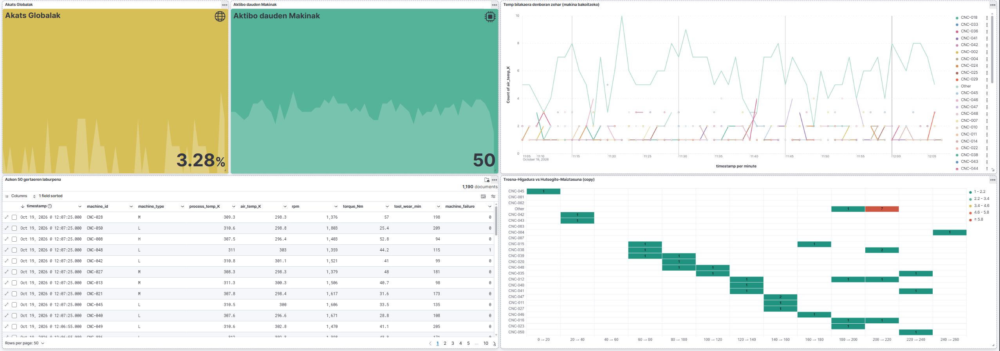
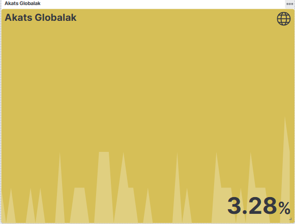
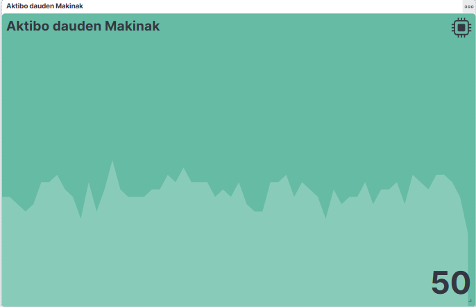
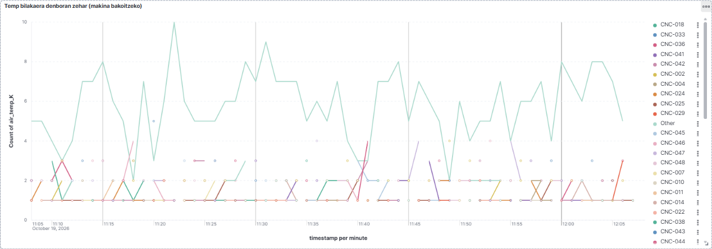
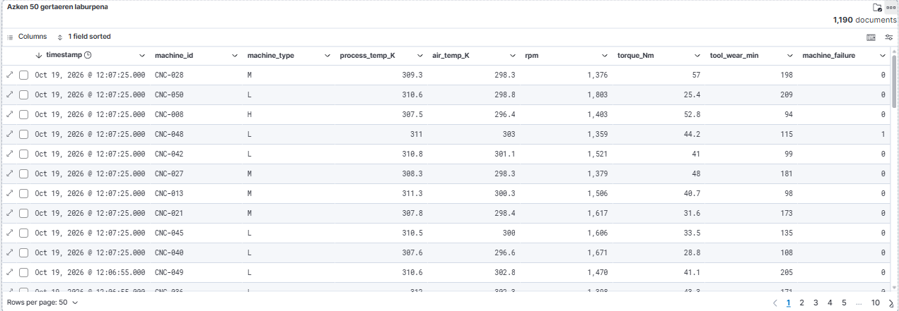
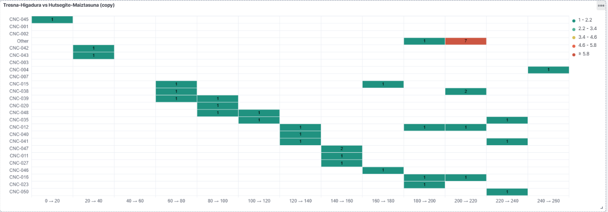

# CNC Guard — Fasez faseko dokumentazioa

Dokumentu honetan CNC Guard proiektuaren garapena hiru fasetan azaltzen da:

1. **1. fasea — Datuak hartu eta biltegiratzea**
2. **2. fasea — Preprocessing-a eta ML eredua entrenatzea**
3. **3. fasea — Streaming bidezko inferentzia eta alertak**

## Arkitektura orokorra

```text
CSV fitxategiak (NFS)
        │
        ▼
Filebeat ──► Kafka ──► NiFi ──► Elasticsearch ──► Kibana
                                  │
                                  └──► Scoring API (3. fasea)
```

Sistema Docker Compose bidez exekutatzen da. Zerbitzu nagusiak Kafka, Filebeat,
Apache NiFi, Elasticsearch eta Kibana dira. Scoring API 3. fasean erabiltzen da.

---

## 1. fasea — Sentsore-datuak hartu eta gorde

### Helburua

Makinetako sentsore-datuak denbora errealean jaso, Kafka bidez garraiatu,
NiFi-n JSON bihurtu eta Elasticsearch-en gordetzea da helburua. Ondoren, datuak
Kibana-n aztertzen dira.

### Datuaren jatorria

Simuladoreak CSV fitxategiak sortzen ditu zerbitzarian. Fitxategi horiek NFS
bidez Z partizioan muntatu ditugu, `/mnt/cnc-stream/` karpetan, eta Filebeat-ek
bertatik irakurtzen ditu.

```bash
sudo mkdir -p /mnt/cnc-stream
sudo mount ZERBITZARI_IP:/opt/cnc-stream /mnt/cnc-stream
ls /mnt/cnc-stream/
```

CSVko lerro bakoitzak neurketa bat adierazten du:

```text
timestamp,machine_id,machine_type,air_temp_K,process_temp_K,rpm,torque_Nm,tool_wear_min,machine_failure,failure_TWF,failure_HDF,failure_PWF,failure_OSF,failure_RNF
```

### Filebeat

Filebeat-ek `/mnt/cnc-stream/*.csv` fitxategiak irakurtzen ditu. Goiburuko
lerroak baztertzen ditu eta gainerako lerroak `cnc-sensors-raw` Kafka topic-era
bidaltzen ditu.

Konfigurazioa [filebeat/filebeat.yml](./filebeat/filebeat.yml) fitxategian dago:

```yaml
filebeat.inputs:
  - type: filestream
    id: cnc-stream
    paths:
      - /mnt/cnc-stream/*.csv
    exclude_lines: ['^timestamp']

output.kafka:
  hosts: ["kafka:9092"]
  topic: "cnc-sensors-raw"
```

Filebeat-en registry-ak aurrez irakurritako posizioa gordetzen du, eta horrela
zerbitzua berrabiaraztean ez ditu lerro guztiak berriro bidaltzen.

### Kafka

Kafka-k Filebeat eta NiFi desakoplatzen ditu. Filebeat-ek datuak bidaltzen
dituen bitartean, NiFi-k bere erritmoan kontsumi ditzake.

- Brokerra Docker sarean: `kafka:9092`
- Topic-a: `cnc-sensors-raw`
- Consumer taldea: `cnc-nifi`

### NiFi flow-a

Flow esportatua [nifi-flows/T3-erronka-1-nifi-flow.json](./nifi-flows/T3-erronka-1-nifi-flow.json)
fitxategian dago.

Prozesadoreen hurrenkera:

```text
ConsumeKafka
     │ success
     ▼
ConvertRecord (CSV → JSON)
     │ success
     ▼
RouteOnAttribute (erregistro hutsa baztertu)
     │ valid_data
     ▼
PutElasticsearchJson
```

1. **ConsumeKafka** prozesadoreak `cnc-sensors-raw` topic-eko mezuak hartzen
   ditu.
2. **ConvertRecord** prozesadoreak CSV edukia JSON erregistro bihurtzen du.
   Horretarako `CSVReader` eta `JsonRecordSetWriter` erabiltzen dira.
3. **RouteOnAttribute** prozesadoreak edukia ez dagoela hutsik egiaztatzen du:
   `${fileSize:gt(0)}`.
4. **PutElasticsearchJson** prozesadoreak erregistroak `cnc-sensors` indexean
   gordetzen ditu.

NiFi-n flow-a inportatu ondoren, controller service hauek konfiguratu eta
gaitu behar dira:

- `Kafka3ConnectionService`: `kafka:9092`
- `CSVReader`: CSVren zutabeen ordena
- `JsonRecordSetWriter`: JSON formatua
- `ElasticSearchClientServiceImpl`: `http://elasticsearch:9200`

### Elasticsearch eta Kibana

Elasticsearch-en indexa:

```text
cnc-sensors
```

Kibana-n index pattern eta data view bat sortu behar da `cnc-sensors` izenarekin,
eta `timestamp` eremua denbora-eremu gisa hautatu.

Gomendatutako bistaratzeak:

| Bistaratzea | Edukia |
|---|---|
| Line chart | tenperatura bilakaera denboran zehar (makina bakoitzeko) `air_temp_K` |
| Heatmap | tresna-higadura vs hutsegite-maiztasuna `tool_wear_min` eta `machine_id` |
| Data table | Azken 50 neurketak |
| KPI | Hutsegite-tasa eta makina aktiboen kopurua |

### Dashboardaren kaptura orokorra

Ondorengo kapturan Kibana dashboard osoa ikus daiteke: hutsegite-tasa globala,
makina aktiboen kopurua, tenperaturaren bilakaera, azken 50 gertaeren taula eta
tresna-higaduraren eta hutsegite-maiztasunaren arteko erlazioa.



### Dashboardeko bistaratzeen kapturak

#### Hutsegite-tasa globala

Dashboardak hutsegiteen ehuneko globala erakusten du. Kapturan balioa
**%3,28** da.



#### Makina aktiboak

KPI honek denbora-tartean datuak bidali dituzten makina aktiboen kopurua
erakusten du. Kapturan **50 makina** agertzen dira.



#### Tenperaturaren bilakaera

Grafikoak `air_temp_K` eremuaren bilakaera erakusten du denboran zehar,
makina bakoitza bereizita.



#### Azken 50 gertaeren laburpena

Taulak azken 50 neurketak erakusten ditu, besteak beste `timestamp`,
`machine_id`, `machine_type`, tenperaturak, `rpm`, `torque_Nm`,
`tool_wear_min` eta `machine_failure` eremuekin.



#### Tresna-higadura eta hutsegite-maiztasuna

Heatmap-ak `tool_wear_min` tarteak eta makina bakoitzeko hutsegite-maiztasuna
erlazionatzen ditu. Kolore eta balio desberdinek hutsegiteen kontzentrazioa
identifikatzen laguntzen dute.



Datuak iritsi diren egiaztatzeko:

```bash
curl http://localhost:9200/cnc-sensors/_count
curl "http://localhost:9200/cnc-sensors/_search?size=1"
```

### 1. faseko egiaztapena

- [ X ] NFS karpetan CSV fitxategiak daude.
- [ X ] Filebeat martxan dago eta ez du errore kritikorik.
- [ X ] Kafka topic-ak mezuak jasotzen ditu.
- [ X ] NiFi-ko prozesadoreak `Running` egoeran daude.
- [ X ] `cnc-sensors` indexak dokumentuak ditu.
- [ X ] Kibana dashboardean datuak agertzen dira.
- [ X ] Kibana eta NiFi-ren kapturak `docs/images/` karpetan gorde dira.

---

## 2. fasea — Preprocessing-a eta eredua entrenatzea

## 3. fasea — Streaming inferentzia eta alertak
