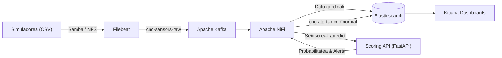

# CNC Guard

## Aurkibidea

- [1. Sarrera eta arkitektura orokorra](#1-sarrera-eta-arkitektura-orokorra)
  - [1.1. Proiektuaren helburua eta esparru teknikoa](#11-proiektuaren-helburua-eta-esparru-teknikoa-cnc-guard)
  - [1.2. Arkitektura globalaren diagrama eta datu-fluxua](#12-arkitektura-globalaren-diagrama-eta-datu-fluxua)
  - [1.3. Azpiegitura edukiontziratua](#13-azpiegitura-edukiontziratua-docker-eta-docker-compose)
  - [1.4. Fitxategi partekatuaren konfigurazioa eta muntaketa](#14-fitxategi-partekatuaren-konfigurazioa-eta-muntaketa-cifs--nfs)
- [2. Datu-ingestioa eta streaming azpiegitura](#2-datu-ingestioa-eta-streaming-azpiegitura)
  - [2.1. Datuen jatorria eta sentsoreen formatua](#21-datuen-jatorria-eta-sentsoreen-formatua-csv)
  - [2.2. Filebeat: konfigurazioa, iragazketa eta egoeraren erregistrua](#22-filebeat-konfigurazioa-iragazketa-eta-egoeraren-erregistrua)
  - [2.3. Apache Kafka: broker-a, topic-ak, partizioak eta kontsumitzaile-taldeak](#23-apache-kafka-broker-a-topic-ak-cnc-sensors-raw-partizioak-eta-kontsumitzaile-taldeak)
  - [2.4. Apache NiFi: hasierako ingestio-flow-a eta Controller Service-ak](#24-apache-nifi-hasierako-ingestio-flow-a-eta-controller-service-ak)
- [3. Datuen azterketa esploratzailea (EDA) eta aurreprozesatzea](#3-datuen-azterketa-esploratzailea-eda-eta-aurreprozesatzea)
  - [3.1. Entrenamendu-datasetaren azterketa](#31-entrenamendu-datasetaren-azterketa-ai4i2020_traincsv)
  - [3.2. Azterketa esploratzailea eta datu-banaketak](#32-azterketa-esploratzailea-eda-eta-datu-banaketak)
  - [3.3. Datuen garbiketa eta data leakage-aren prebentzioa](#33-datuen-garbiketa-eta-datu-ihesaren-data-leakage-prebentzioa)
  - [3.4. Kategoria-aldagaien kodetzea](#34-kategoria-aldagaien-kodetzea-one-hot-encoding)
  - [3.5. Ezaugarri eratorrien sorrera](#35-ezaugarri-eratorrien-sorrera-feature-engineering)
- [4. Machine Learning ereduaren entrenamendua eta ebaluazioa](#4-machine-learning-ereduaren-entrenamendua-eta-ebaluazioa)
  - [4.1. Entrenamendu- eta balidazio-multzoen banaketa](#41-entrenamendu--eta-balidazio-multzoen-banaketa-estrategikoa)
  - [4.2. Klase-desoreka tratatzeko estrategiak](#42-klase-desoreka-tratatzeko-estrategiak-class-weight-eta-smote)
  - [4.3. Algoritmoen entrenamendua](#43-algoritmoen-entrenamendua-random-forest-vs-xgboost)
  - [4.4. Balidazio gurutzatua](#44-balidazio-gurutzatua-stratified-k-fold-cross-validation)
  - [4.5. Ereduen arteko konparazioa eta metrikak](#45-ereduen-arteko-konparazioa-eta-metrikak-precision-recall-f1-roc-auc)
  - [4.6. Atalasearen doikuntza eta kostu ekonomikoa](#46-atalasearen-doikuntza-threshold-tuning-eta-kostu-ekonomikoaren-azterketa)
  - [4.7. Ezaugarrien garrantzia eta ereduaren biltegiratzea](#47-ezaugarrien-garrantzia-feature-importance-eta-ereduaren-biltegiratzea-pkl)
- [5. Scoring APIa eta ML inferentzia zerbitzua](#5-scoring-apia-eta-ml-inferentzia-zerbitzua)
  - [5.1. FastAPI bidezko mikrozerbitzuaren arkitektura](#51-fastapi-bidezko-mikrozerbitzuaren-arkitektura-eta-egitura)
  - [5.2. Ereduaren karga eta Pydantic balidazioa](#52-ereduaren-karga-dinamikoa-eta-pydantic-balidazioa-sentsoresaria)
  - [5.3. Ezaugarri eratorriak eta ezaugarri-ordena](#53-ezaugarri-eratorrien-kalkulua-eta-ezaugarri-ordenaren-koherentzia)
  - [5.4. Atalase operatiboa eta alerta-mailak](#54-atalase-operatiboa-eta-alerta-mailen-definizioa-ok-kontuz-larria)
  - [5.5. APIaren autentifikazioa eta segurtasuna](#55-apiaren-autentifikazioa-eta-segurtasuna-x-api-key)
  - [5.6. Dockerizazioa eta egiaztapen-probak](#56-dockerizazioa-eta-egiaztapen-probak-curl-health-eta-predict)
- [6. Denbora errealeko pipelinearen integrazioa eta alerta-sistema](#6-denbora-errealeko-pipelinearen-integrazioa-eta-alerta-sistema)
  - [6.1. NiFi Streaming Middleware-aren flow-a](#61-nifi-streaming-middleware-aren-flow-osoaren-diseinua)
  - [6.2. Datuen eraldaketa fisikoa](#62-datuen-eraldaketa-fisikoa-kelvin--celsius-bihurketa)
  - [6.3. NiFi eta Scoring APIaren arteko komunikazioa](#63-nifi-eta-scoring-apiaren-arteko-komunikazioa-invokehttp)
  - [6.4. Aurreikuspenen bideratzea eta Elasticsearch biltegiratzea](#64-aurreikuspenen-bideratze-dinamikoa-eta-indize-anitzeko-biltegiratzea-elasticsearch-en)
  - [6.5. Telegram bidezko alerta-sistema](#65-alerta-sistema-automatizatua-telegram-bidez-kontuz-eta-larria)
- [7. Ustiapena, bistaratzea eta monitorizazioa Kibana-n](#7-ustiapena-bistaratzea-eta-monitorizazioa-kibana-n)
  - [7.1. Kibana Data View eta Index Pattern](#71-kibana-data-view-eta-index-pattern-en-konfigurazioa)
  - [7.2. Panela eta bistaratzeak](#72-panela-eta-bistaratzeak-kpiak-line-chart-ak-heatmap-ak-eta-gertaera-taulak)
  - [7.3. Denbora errealeko monitorizazioa](#73-denbora-errealeko-monitorizazioa-eta-sentsoreen-jarraipena)
- [8. Ondorioak eta etorkizuneko hobekuntzak](#8-ondorioak-eta-etorkizuneko-hobekuntzak)
  - [8.1. Lortutako emaitzak eta betetako helburuak](#81-lortutako-emaitzen-laburpena-eta-betetako-helburuak)
  - [8.2. Muga teknikoak](#82-sistematik-hautemandako-muga-teknikoak)
  - [8.3. Etorkizuneko lan-ildoak](#83-etorkizuneko-lan-ildoak-mlops-ereduaren-birentrenamendua-eta-ezaugarri-berriak)

## 1. SARRERA ETA ARKITEKTURA OROKORRA

### 1.1. Proiektuaren helburua eta esparru teknikoa (CNC Guard)

CNC Guard sistema adimenduna da, CNC makinen sentsore-datuak denbora errealean jaso, prozesatu eta aztertzeko diseinatua. Sistemaren helburu nagusia makinen balizko matxurak edo portaera anomaloak aurrez hautematea da, mantentze-lanak planifikatu eta geldialdi ezustekoak murrizteko.

Horretarako, datuak CSV fitxategietatik hartu eta Filebeat, Kafka eta NiFi erabiliz streaming-pipeline batean garraiatzen dira. Ondoren, Machine Learning ereduak datuak aztertu eta arrisku-maila kalkulatzen du; emaitzak Elasticsearch-en gordetzen dira eta Kibana-n bistaratzen dira. Alerta-maila larrien kasuan, sistemak jakinarazpenak bidaltzen ditu Telegram bidez.

Proiektuaren esparru teknikoak honako osagai hauek biltzen ditu: Docker bidezko azpiegitura edukiontziratua, datu-ingestioa eta streaming-a, datuen aurreprozesatzea, ML ereduaren entrenamendua, FastAPI bidezko inferentzia-zerbitzua, Elasticsearch eta Kibana bidezko monitorizazioa, eta alerta automatizatuak.

### 1.2. Arkitektura globalaren diagrama eta datu-fluxua
Atal honetan proiektuaren funtzionamendu orokorra eta informazioaren ibilbidea azaltzen dira. 

Jarraian agertzen den diagramak (Mermaid bidez diseinatua) sistemaren osagai nagusiak, haien arteko elkarrekintzak eta datu-fluxua modu bisual eta argian erakusten ditu. Irudikapen honi esker, sistemaren prozesu osoa –hasierako interakziotik hasi eta amaierako emaitzara arte– errazago ulertu ahal izango da.


### 1.3. Azpiegitura edukiontziratua (Docker eta Docker Compose)
#### Docker Compose-ren helburua
CNC Guard proiektuan Docker eta Docker Compose erabili dira sistemaren azpiegitura osoa edukiontzien bidez hedatzeko eta kudeatzeko. Horri esker, proiektuko zerbitzu guztiak ingurune isolatu eta independenteetan exekuta daitezke, bakoitzaren mendekotasunak eta konfigurazioak kontrolatuz.

docker-compose.yml fitxategiak sistemaren zerbitzu guztiak definitzen ditu, baita haien arteko komunikazioa, sare-konfigurazioa, portuak, ingurune-aldagaiak, bolumen iraunkorrak eta abiarazte-mendekotasunak ere.

Konfiguratutako azpiegiturak honako zerbitzu hauek biltzen ditu:
| Zerbitzua | Batezbestekoa 
|---|---|
| Apache Kafka | Sentsoreen datuak bufferizatu eta streaming bidez banatzea. |
| Filebeat | Fitxategi partekatuko datuak irakurri eta Kafkara bidaltzea. |
| Apache NiFi | Datuen ingestioa, eraldaketa eta bideratze automatikoa. |
| Elasticsearch | Datuak eta aurreikuspenen emaitzak biltegiratzea eta indexatzea. |
| Kibana | Datuak bistaratzea eta monitorizazio-panelak sortzea. |
| Scoring API | Machine Learning ereduaren inferentziak eskaintzea FastAPI bidez. |

#### Filebeat — Fitxategien irakurketa eta bidalketa

Filebeat-ek fitxategi partekatuan sortzen diren sentsoreen datuak irakurtzen ditu eta konfiguratutako irteeraren bidez Kafkara bidaltzen ditu.

- `filebeat.yml`: irakurketa-iturburua, datuen iragazketa eta Kafka-rako konexioa definitzen ditu.
- `user: root`: fitxategi partekatuko edukia irakurtzeko beharrezko baimenak izatea ahalbidetzen du.
- `--strict.perms=false`: konfigurazio-fitxategiaren baimenei buruzko egiaztapen zorrotza desgaitzen du.
- `filebeat-data`: irakurritako fitxategien egoera eta aurrerapena gordetzen ditu, berrabiarazteetan prozesamendua kontrolatzeko.
- `cnc-stream-cifs`: CIFS bidez muntatutako fitxategi partekatua irakurtzeko erabiltzen da.

#### Apache NiFi — Datuen eraldaketa eta bideratzea
NiFi datuen streaming pipeline-aren koordinazioaz arduratzen da. Kafkatik jasotako mezuak prozesatu, beharrezko eraldaketak egin, Scoring APIarekin komunikatu eta emaitzak Elasticsearch-era bidaltzen ditu.

- `8443:8443`: NiFi-ren HTTPS web-interfazea eskuragarri jartzen du.
- `SINGLE_USER_CREDENTIALS_USERNAME` eta `SINGLE_USER_CREDENTIALS_PASSWORD`: web-interfazeko erabiltzailearen autentifikazioa konfiguratzen dute.
- `NIFI_WEB_HTTPS_PORT`: HTTPS bidezko sarbidearen portua definitzen du.
- `depends_on`: Kafka eta Elasticsearch zerbitzuak NiFi baino lehen abiaraztea ezartzen du.

#### Elasticsearch — Datuen biltegiratzea
Elasticsearch sistemaren biltegiratze eta bilaketa-motorra da. Sentsoreen erregistroak eta Machine Learning ereduak sortutako aurreikuspenak indexatzeko erabiltzen da.

- `discovery.type=single-node`: nodo bakarreko konfigurazioa erabiltzen du.
- `xpack.security.enabled=true`: autentifikazio- eta segurtasun-funtzioak aktibatzen ditu.
- `ELASTIC_PASSWORD`: administratzailearen pasahitza ezartzen du.
- `ES_JAVA_OPTS`: JVM-rako memoria-mugak definitzen ditu.
- `es-data`: datuen iraunkortasuna bermatzen du, edukiontzia berrabiarazi edo ordezkatu arren.

#### Kibana — Datuen bistaratzea
Kibanak Elasticsearch-en gordetako informazioa grafikoki aztertzeko aukera ematen du. Monitorizazio-panelak, KPIak, denbora-serieak, heatmap-ak eta gertaeren taulak sortzeko erabiltzen da.

- `ELASTICSEARCH_HOSTS`: Elasticsearch zerbitzuaren helbidea definitzen du.
- `ELASTICSEARCH_USERNAME`: Kibana-ren eta Elasticsearch-en arteko komunikaziorako erabiltzailea zehazten du.
- `ELASTICSEARCH_PASSWORD`: erabiltzaile horren pasahitza definitzen du.
- `XPACK_ENCRYPTEDSAVEDOBJECTS_ENCRYPTIONKEY`: Kibana-k objektu sentikorrak enkriptatzeko erabiltzen duen gakoa definitzen du.
- `5601:5601`: Kibana-ren web-interfazea eskuragarri jartzen du.

#### Scoring API — Machine Learning inferentzia
Scoring APIa FastAPI erabiliz garatutako mikrozerbitzua da. Aurretik entrenatutako Machine Learning eredua kargatzen du eta NiFIk bidalitako sentsoreen datuekin hutsegiteen probabilitatea kalkulatzen du.

- `build.context`: APIaren Docker irudia eraikitzeko erabiliko den direktorioa definitzen du.
- `8000:8000`: APIaren HTTP portua kanpora irekitzen du.
- `./models:/models:ro`: entrenatutako eredua edukiontzian muntatzen du, irakurtzeko soilik.
- `MODEL_PATH`: erabiliko den `.pkl` ereduaren kokapena definitzen du.
- `CORS_ORIGINS`: APIra konektatzeko baimendutako jatorriak zehazten ditu.
- `API_KEY_SECRET`: APIaren autentifikaziorako erabilitako gako sekretua definitzen du.

#### Bolumen iraunkorrak eta fitxategi partekatua
Docker-en bolumenak erabiltzen dira edukiontziak berrabiarazi arren beharrezko informazioa mantentzeko.

Proiektuan hiru bolumen nagusi definitu dira:

- `filebeat-data`: Filebeat-en egoera eta irakurketa-aurrerapena gordetzeko.
- `es-data`: Elasticsearch-en indexatutako informazioa gordetzeko.
- `cnc-stream-cifs`: sareko fitxategi partekatua CIFS protokoloaren bidez muntatzeko.

Azken bolumen horrek `192.168.75.150` zerbitzarian kokatutako `cnc-stream` direktorio partekatua erabiltzen du. `ro` aukerak irakurtzeko soilik muntatzen dela adierazten du.

#### Edukiontzien abiaraztea eta kudeaketa
**Zerbitzu guztiak batera abiarazteko:**
```bash
docker compose up -d --build
```

**Edukiontzien egoera ikusteko:**
```bash
docker compose ps
```

**Zerbitzu jakin baten log-ak ikusteko:**
```bash
docker compose logs -f kafka
```

**Zerbitzu guztiak gelditzeko:**
```bash
docker compose down
```
### 1.3.1. Ingurune-aldagaien konfigurazioa (`.env`)

Docker Compose-ren konfigurazioan kredentzialak eta informazio sentikorra zuzenean idatzi beharrean, ingurune-aldagaiak erabiltzen dira. Horretarako, `.env` fitxategia erabiltzen da.

Fitxategi horretan zerbitzuen konfigurazio pribatuak gordetzen dira, hala nola:

- NiFi-ren erabiltzaile-izena eta pasahitza.
- Elasticsearch-en administratzailearen pasahitza.
- Kibana-ren enkriptatze-gakoa.
- Scoring APIaren autentifikazio-gakoa.
- CIFS sare-partekatuaren erabiltzaile-izena eta pasahitza.

Docker Compose-k automatikoki irakurtzen ditu `.env` fitxategiko aldagaiak eta `docker-compose.yml` fitxategian `${ALDAGAIA}` sintaxiaren bidez erabiltzeko aukera ematen du.

#### `.env.example` fitxategia

Taldekide guztiek proiektua exekutatu ahal izateko, `.env.example` fitxategia gordeko da Git biltegian. Fitxategi horrek behar diren aldagai guztiak definituko ditu, baina benetako pasahitzik gabe.

Adibidez:

```env
# Apache NiFi
NIFI_USER=admin
NIFI_PASSWORD=CHANGE_ME_NIFI_PASSWORD

# Elasticsearch
ELASTIC_PASSWORD=CHANGE_ME_ELASTIC_PASSWORD

# Kibana
KIBANA_SYSTEM_PASSWORD=CHANGE_ME_KIBANA_PASSWORD
KIBANA_ENCRYPTION_KEY=CHANGE_ME_WITH_32_CHARACTERS_MINIMUM

# Scoring API
API_KEY_SECRET=CHANGE_ME_API_SECRET

# CIFS shared folder
CIFS_USERNAME=CHANGE_ME_CIFS_USER
CIFS_PASSWORD=CHANGE_ME_CIFS_PASSWORD
```
#### `.gitignore` fitxategia
Benetako .env fitxategia Git-etik kanpo utzi behar da, kredentzialak publikoki ez zabaltzeko.

Horretarako, .gitignore fitxategian honako lerro hauek gehituko dira:
```gitignore
# Environment variables and secrets
.env
.env.*
!.env.example
```

#### Taldekideen konfigurazioa
Taldekide bakoitzak bere .env fitxategia sortuko du .env.example fitxategitik abiatuta:
```bash
cp .env.example .env
```
Ondoren, dagokion ingurunean behar diren kredentzialak eta konfigurazio-balioak sartuko ditu.

Horrela, proiektuaren konfigurazio-egitura partekatzen da, baina kredentzial pertsonalak eta informazio sentikorra ez dira Git biltegian gordetzen.

**Garrantzitsua:** `.env.example` fitxategiak ez ditu benetako pasahitzak izan behar. Hala ere, zuen azpiegiturak CIFS partekatutako karpeta eta gainerako zerbitzuak behar dituenez, exekutatzeko benetako kredentzialak modu seguruan partekatu beharko dituzue, adibidez, kanal pribatu baten bidez.
### 1.4. Fitxategi partekatuaren konfigurazioa eta muntaketa (CIFS / NFS)

## 2. DATU-INGESTIOA ETA STREAMING AZPIEGITURA

### 2.1. Datuen jatorria eta sentsoreen formatua (CSV)

CNC Guard proiektuak **AI4I 2020 Predictive Maintenance Dataset** datu-multzoa erabiltzen du oinarri gisa. Datu-multzo horrek industria-ingurune bateko CNC makinen funtzionamendua eta sentsoreen neurketak simulatzen ditu, makinen hutsegiteak aurreikusteko eta mantentze prediktiboa lantzeko.

Datuak CSV (*Comma-Separated Values*) formatuan gordetzen dira. Fitxategi bakoitzaren lerro batek neurketa edo erregistro bat adierazten du, eta zutabe bakoitzak makinaren egoerari, funtzionamendu-parametroei edo hutsegiteei buruzko informazioa jasotzen du.

CSV fitxategiaren egitura honako hau da:

```text
timestamp,machine_id,machine_type,air_temp_K,process_temp_K,rpm,torque_Nm,tool_wear_min,machine_failure,failure_TWF,failure_HDF,failure_PWF,failure_OSF,failure_RNF
```

**Zutabeen deskribapena:**

| Zutabea | Deskribapena | Datu mota / Unitatea |
|---|---|---|
| `timestamp` | Neurketa egin den data eta ordua adierazten ditu. | Datetime (UTC) |
| `machine_id` | Neurketa egin duen makinaren identifikatzaile bakarra. | String |
| `machine_type` | Makinaren mota edo kategoria adierazten du (L, M edo H). | Kategorikoa |
| `air_temp_K` | Inguruko airearen tenperatura adierazten du. | Float (Kelvin) |
| `process_temp_K` | Makina-prozesuaren tenperatura adierazten du. | Float (Kelvin) |
| `rpm` | Makinaren biraketa-abiadura adierazten du. | Integer (RPM) |
| `torque_Nm` | Makinaren ardatzean aplikatutako momentu eragilea adierazten du. | Float (N·m) |
| `tool_wear_min` | Erremintak erabilitako denbora metatua adierazten du. | Integer (minutuak) |
| `machine_failure` | Makinak hutsegiterik izan duen adierazten du. | Boolean (0/1) |
| `failure_TWF` | Erremintaren higadurarekin lotutako hutsegitea (Tool Wear Failure). | Boolean (0/1) |
| `failure_HDF` | Beroaren disipazioarekin lotutako hutsegitea (Heat Dissipation Failure). | Boolean (0/1) |
| `failure_PWF` | Potentzia-prozesuarekin lotutako hutsegitea (Power Failure). | Boolean (0/1) |
| `failure_OSF` | Gehiegizko tentsio mekanikoarekin lotutako hutsegitea (Overstrain Failure). | Boolean (0/1) |
| `failure_RNF` | Ausazko hutsegitea (Random Failure). | Boolean (0/1) |

Hutsegiteen adierazleek balio bitarrak erabiltzen dituzte: `0` balioak hutsegiterik ez dagoela adierazten du, eta `1` balioak, berriz, dagokion hutsegite mota gertatu dela.

`machine_failure` aldagaia Machine Learning ereduaren **helburu-aldagaia (target variable)** da; hau da, ereduak makina baten hutsegitea gertatuko den aurreikusteko erabiltzen duen aldagaia. Gainerako `failure_*` zutabeek hutsegite mota zehazten dute, eta datuen azterketan eta ebaluazioan erabil daitezke.

Bestalde, `machine_id` eta `machine_type` aldagaiek makinak identifikatzeko eta sailkatzeko balio dute. Tenperatura, biraketa-abiadura, momentu eragilea eta erremintaren higadura, berriz, makinaren egoera operatiboa deskribatzen duten sentsore-ezaugarriak dira.

**Datuen prozesamenduan kontuan hartu beharreko alderdiak:**

- Tenperaturak Kelvin-etan jasotzen dira jatorrizko datuetan. Streaming pipeline-an Celsius graduetara bihurtzen dira, monitorizazioa eta interpretazioa errazteko.
- `rpm`, `torque_Nm` eta `tool_wear_min` aldagaiek makinaren egoera mekanikoa eta erabilera-maila deskribatzen dituzte.
- `machine_type` aldagai kategorikoa da, eta entrenamendu-fasean kodetu behar da ereduak erabil dezan.
- Hutsegiteen adierazleak datu historikoen analisirako erabiltzen dira. Inferentzia-fasean, ordea, ereduak sentsoreen neurketetatik abiatuta kalkulatzen du hutsegitearen probabilitatea.
- Datuen ingestioan, erregistro bakoitzaren denbora-zigilua eta makinaren identifikatzailea mantentzen dira, ondorengo monitorizazioa eta trazabilitatea bermatzeko.

CSV formatua aukeratu da datuak modu sinple eta egituratuan gordetzeko, baita Filebeat, Apache Kafka eta Apache NiFi bezalako tresnekin erraz integratzeko ere.
### 2.2. Filebeat: konfigurazioa, iragazketa eta egoeraren erregistrua

### 2.3. Apache Kafka: broker-a, topic-ak (`cnc-sensors-raw`), partizioak eta kontsumitzaile-taldeak

### 2.4. Apache NiFi: hasierako ingestio-flow-a eta Controller Service-ak

## 3. DATUEN AZTERKETA ESPLORATZAILEA (EDA) ETA AURREPROZESATZEA

### 3.1. Entrenamendu-datasetaren azterketa (`ai4i2020_train.csv`)

### 3.2. Azterketa esploratzailea (EDA) eta datu-banaketak

### 3.3. Datuen garbiketa eta datu-ihesaren (data leakage) prebentzioa

### 3.4. Kategoria-aldagaien kodetzea (One-Hot Encoding)

### 3.5. Ezaugarri eratorrien sorrera (Feature Engineering)

## 4. MACHINE LEARNING EREDUAREN ENTRENAMENDUA ETA EBALUAZIOA

### 4.1. Entrenamendu- eta balidazio-multzoen banaketa estrategikoa

### 4.2. Klase-desoreka tratatzeko estrategiak (Class Weight eta SMOTE)

### 4.3. Algoritmoen entrenamendua: Random Forest vs XGBoost

### 4.4. Balidazio gurutzatua (Stratified K-Fold Cross-Validation)

### 4.5. Ereduen arteko konparazioa eta metrikak (Precision, Recall, F1, ROC-AUC)

### 4.6. Atalasearen doikuntza (Threshold Tuning) eta kostu ekonomikoaren azterketa

### 4.7. Ezaugarrien garrantzia (Feature Importance) eta ereduaren biltegiratzea (`.pkl`)

## 5. SCORING APIA ETA ML INFERENTZIA ZERBITZUA

### 5.1. FastAPI bidezko mikrozerbitzuaren arkitektura eta egitura

### 5.2. Ereduaren karga dinamikoa eta Pydantic balidazioa (`SentsoreSaria`)

### 5.3. Ezaugarri eratorrien kalkulua eta ezaugarri-ordenaren koherentzia

### 5.4. Atalase operatiboa eta alerta-mailen definizioa (OK, KONTUZ, LARRIA)

### 5.5. APIaren autentifikazioa eta segurtasuna (`X-API-Key`)

### 5.6. Dockerizazioa eta egiaztapen-probak (`curl`, `/health` eta `/predict`)

## 6. DENBORA ERREALEKO PIPELINEAREN INTEGRAZIOA ETA ALERTA-SISTEMA

### 6.1. NiFi Streaming Middleware-aren flow osoaren diseinua

### 6.2. Datuen eraldaketa fisikoa (Kelvin → Celsius bihurketa)

### 6.3. NiFi eta Scoring APIaren arteko komunikazioa (`InvokeHTTP`)

### 6.4. Aurreikuspenen bideratze dinamikoa eta indize anitzeko biltegiratzea Elasticsearch-en

### 6.5. Alerta-sistema automatizatua Telegram bidez (KONTUZ eta LARRIA)

## 7. USTIAPENA, BISTARATZEA ETA MONITORIZAZIOA KIBANA-N

### 7.1. Kibana Data View eta Index Pattern-en konfigurazioa

### 7.2. Panela eta bistaratzeak (KPIak, line chart-ak, heatmap-ak eta gertaera-taulak)

### 7.3. Denbora errealeko monitorizazioa eta sentsoreen jarraipena

## 8. ONDORIOAK ETA ETORKIZUNEKO HOBEKUNTZAK

### 8.1. Lortutako emaitzen laburpena eta betetako helburuak

### 8.2. Sistematik hautemandako muga teknikoak

### 8.3. Etorkizuneko lan-ildoak (MLOps, ereduaren birentrenamendua eta ezaugarri berriak)
