# CNC Guard

## Aurkibidea

- [1. Sarrera eta arkitektura orokorra](#1-sarrera-eta-arkitektura-orokorra)
  - [1.1. Proiektuaren helburua eta esparru teknikoa](#11-proiektuaren-helburua-eta-esparru-teknikoa-cnc-guard)
  - [1.2. Arkitektura globalaren diagrama eta datu-fluxua](#12-arkitektura-globalaren-diagrama-eta-datu-fluxua)
  - [1.3. Azpiegitura edukiontziratua](#13-azpiegitura-edukiontziratua-docker-eta-docker-compose)
  - [1.4. Fitxategi partekatuaren konfigurazioa eta muntaketa](#14-fitxategi-partekatuaren-konfigurazioa-eta-muntaketa-cifs--nfs)
- [2. Datu-ingestioa eta streaming azpiegitura](#2-datu-ingestioa-eta-streaming-azpiegitura)
  - [2.1. Datuen jatorria eta sentsoreen formatua](#21-datuen-jatorria-eta-sentsoreen-formatua-csv)
  - [2.2. Filebeat: konfigurazioa, iragazketa eta egoeraren erregistrua](#22-filebeat-konfigurazioa-iragazketa-eta-egoeraren-erregistrua)
  - [2.3. Apache Kafka: broker-a, topic-ak, partizioak eta kontsumitzaile-taldeak](#23-apache-kafka-broker-a-topic-ak-cnc-sensors-raw-partizioak-eta-kontsumitzaile-taldeak)
  - [2.4. Apache NiFi: hasierako ingestio-flow-a eta Controller Service-ak](#24-apache-nifi-hasierako-ingestio-flow-a-eta-controller-service-ak)
- [3. Datuen azterketa esploratzailea (EDA) eta aurreprozesatzea](#3-datuen-azterketa-esploratzailea-eda-eta-aurreprozesatzea)
  - [3.1. Entrenamendu-datasetaren azterketa](#31-entrenamendu-datasetaren-azterketa-ai4i2020_traincsv)
  - [3.2. Azterketa esploratzailea eta datu-banaketak](#32-azterketa-esploratzailea-eda-eta-datu-banaketak)
  - [3.3. Datuen garbiketa eta data leakage-aren prebentzioa](#33-datuen-garbiketa-eta-datu-ihesaren-data-leakage-prebentzioa)
  - [3.4. Kategoria-aldagaien kodetzea](#34-kategoria-aldagaien-kodetzea-one-hot-encoding)
  - [3.5. Ezaugarri eratorrien sorrera](#35-ezaugarri-eratorrien-sorrera-feature-engineering)
- [4. Machine Learning ereduaren entrenamendua eta ebaluazioa](#4-machine-learning-ereduaren-entrenamendua-eta-ebaluazioa)
  - [4.1. Entrenamendu- eta balidazio-multzoen banaketa](#41-entrenamendu--eta-balidazio-multzoen-banaketa-estrategikoa)
  - [4.2. Klase-desoreka tratatzeko estrategiak](#42-klase-desoreka-tratatzeko-estrategiak-class-weight-eta-smote)
  - [4.3. Algoritmoen entrenamendua](#43-algoritmoen-entrenamendua-random-forest-vs-xgboost)
  - [4.4. Balidazio gurutzatua](#44-balidazio-gurutzatua-stratified-k-fold-cross-validation)
  - [4.5. Ereduen arteko konparazioa eta metrikak](#45-ereduen-arteko-konparazioa-eta-metrikak-precision-recall-f1-roc-auc)
  - [4.6. Atalasearen doikuntza eta kostu ekonomikoa](#46-atalasearen-doikuntza-threshold-tuning-eta-kostu-ekonomikoaren-azterketa)
  - [4.7. Ezaugarrien garrantzia eta ereduaren biltegiratzea](#47-ezaugarrien-garrantzia-feature-importance-eta-ereduaren-biltegiratzea-pkl)
- [5. Scoring APIa eta ML inferentzia zerbitzua](#5-scoring-apia-eta-ml-inferentzia-zerbitzua)
  - [5.1. FastAPI bidezko mikrozerbitzuaren arkitektura](#51-fastapi-bidezko-mikrozerbitzuaren-arkitektura-eta-egitura)
  - [5.2. Ereduaren karga eta Pydantic balidazioa](#52-ereduaren-karga-dinamikoa-eta-pydantic-balidazioa-sentsoresaria)
  - [5.3. Ezaugarri eratorriak eta ezaugarri-ordena](#53-ezaugarri-eratorrien-kalkulua-eta-ezaugarri-ordenaren-koherentzia)
  - [5.4. Atalase operatiboa eta alerta-mailak](#54-atalase-operatiboa-eta-alerta-mailen-definizioa-ok-kontuz-larria)
  - [5.5. APIaren autentifikazioa eta segurtasuna](#55-apiaren-autentifikazioa-eta-segurtasuna-x-api-key)
  - [5.6. Dockerizazioa eta egiaztapen-probak](#56-dockerizazioa-eta-egiaztapen-probak-curl-health-eta-predict)
- [6. Denbora errealeko pipelinearen integrazioa eta alerta-sistema](#6-denbora-errealeko-pipelinearen-integrazioa-eta-alerta-sistema)
  - [6.1. NiFi Streaming Middleware-aren flow-a](#61-nifi-streaming-middleware-aren-flow-osoaren-diseinua)
  - [6.2. Datuen eraldaketa fisikoa](#62-datuen-eraldaketa-fisikoa-kelvin--celsius-bihurketa)
  - [6.3. NiFi eta Scoring APIaren arteko komunikazioa](#63-nifi-eta-scoring-apiaren-arteko-komunikazioa-invokehttp)
  - [6.4. Aurreikuspenen bideratzea eta Elasticsearch biltegiratzea](#64-aurreikuspenen-bideratze-dinamikoa-eta-indize-anitzeko-biltegiratzea-elasticsearch-en)
  - [6.5. Telegram bidezko alerta-sistema](#65-alerta-sistema-automatizatua-telegram-bidez-kontuz-eta-larria)
- [7. Ustiapena, bistaratzea eta monitorizazioa Kibana-n](#7-ustiapena-bistaratzea-eta-monitorizazioa-kibana-n)
  - [7.1. Kibana Data View eta Index Pattern](#71-kibana-data-view-eta-index-pattern-en-konfigurazioa)
  - [7.2. Panela eta bistaratzeak](#72-panela-eta-bistaratzeak-kpiak-line-chart-ak-heatmap-ak-eta-gertaera-taulak)
  - [7.3. Denbora errealeko monitorizazioa](#73-denbora-errealeko-monitorizazioa-eta-sentsoreen-jarraipena)
- [8. Ondorioak eta etorkizuneko hobekuntzak](#8-ondorioak-eta-etorkizuneko-hobekuntzak)
  - [8.1. Lortutako emaitzak eta betetako helburuak](#81-lortutako-emaitzen-laburpena-eta-betetako-helburuak)
  - [8.2. Muga teknikoak](#82-sistematik-hautemandako-muga-teknikoak)
  - [8.3. Etorkizuneko lan-ildoak](#83-etorkizuneko-lan-ildoak-mlops-ereduaren-birentrenamendua-eta-ezaugarri-berriak)

## 1. SARRERA ETA ARKITEKTURA OROKORRA

### 1.1. Proiektuaren helburua eta esparru teknikoa (CNC Guard)

CNC Guard sistema adimenduna da, CNC makinen sentsore-datuak denbora errealean jaso, prozesatu eta aztertzeko diseinatua. Sistemaren helburu nagusia makinen balizko matxurak edo portaera anomaloak aurrez hautematea da, mantentze-lanak planifikatu eta geldialdi ezustekoak murrizteko.

Horretarako, datuak CSV fitxategietatik hartu eta Filebeat, Kafka eta NiFi erabiliz streaming-pipeline batean garraiatzen dira. Ondoren, Machine Learning ereduak datuak aztertu eta arrisku-maila kalkulatzen du; emaitzak Elasticsearch-en gordetzen dira eta Kibana-n bistaratzen dira. Alerta-maila larrien kasuan, sistemak jakinarazpenak bidaltzen ditu Telegram bidez.

Proiektuaren esparru teknikoak honako osagai hauek biltzen ditu: Docker bidezko azpiegitura edukiontziratua, datu-ingestioa eta streaming-a, datuen aurreprozesatzea, ML ereduaren entrenamendua, FastAPI bidezko inferentzia-zerbitzua, Elasticsearch eta Kibana bidezko monitorizazioa, eta alerta automatizatuak.

### 1.1.1. Adimen artifizialaren eta ikaskuntza automatikoaren oinarriak

CNC Guard proiektua ulertzeko, beharrezkoa da Adimen Artifizialaren (AA) eta Ikaskuntza Automatikoaren (*Machine Learning*) arteko harremana eta bakoitzaren ezaugarriak bereiztea.

**Adimen Artifiziala (AA)** makinek gizakiaren adimenarekin lotutako atazak egiteko duten gaitasuna garatzen duen informatika-arloa da. Besteak beste, informazioa aztertzea, patroiak identifikatzea, erabakiak hartzea eta arazoak ebaztea bilatzen du.

Adimen Artifizialaren barruan bi kontzeptu nagusi bereizten dira:

- **Adimen Artifizial ahula (Narrow AI):** ataza edo arazo zehatz bat ebazteko diseinatutako sistemak dira. Ez dute gizakiaren adimen orokorrik, baizik eta aurrez definitutako esparru batean jarduteko gaitasuna. CNC Guard sistema mota honen barruan kokatzen da, bere helburu bakarra CNC makinen hutsegiteak aurreikustea baita.

- **Adimen Artifizial indartsua (Strong AI / AGI):** edozein arlotan gizakiaren antzeko arrazoiketa, ikaskuntza eta arazoak ebazteko gaitasun orokorra izango lukeen adimen artifiziala da. Ez litzateke ataza bakar batera mugatuko, eta ezagutza arlo desberdinetara transferitzeko gai izango litzateke. CNC Guard ez da mota honetako sistema bat.

#### Adimen Artifiziala eta Machine Learning arteko harremana

*Machine Learning* Adimen Artifizialaren azpiarlo bat da. Bere helburua da ordenagailuek datuetatik abiatuta ereduak eta patroiak ikastea, arau guztiak eskuz programatu behar izan gabe.

Bi kontzeptuen arteko desberdintasun nagusia honako hau da:

- **Adimen Artifiziala:** sistema adimendunak garatzeko arlo orokorra da. Arauetan, logikan edo ikaskuntza automatikoan oinarritutako teknikak erabil ditzake.
- **Machine Learning:** datuetatik ikasten duten algoritmoak erabiltzen dituen AAren azpimultzoa da. Ereduak entrenamendu-datuetan aurkitutako erlazioak erabiltzen ditu aurrez ikusi gabeko egoerei buruzko iragarpenak egiteko.

Adibidez, mantentze-lan tradizional batean, makina baten tenperatura 80 °C-tik gorakoa bada alerta bat sortzeko arau finko bat programatu daiteke. CNC Guard sisteman, aldiz, Machine Learning eredua sentsoreen hainbat parametro aztertzen entrenatzen da, haien arteko erlazioak ikasiz eta hutsegite baten probabilitatea kalkulatuz.

#### Ikaskuntza automatikoko sistema motak

Machine Learning sistemak erabiltzen duten ikaskuntza-motaren arabera sailka daitezke:

| Ikaskuntza mota | Ezaugarriak | Industria-aplikazioak |
|---|---|---|
| **Gainbegiratua (Supervised Learning)** | Etiketatutako datuekin entrenatzen da. Sarrerako datuak eta dagozkien emaitza zuzenak erabiltzen ditu ereduak ikasteko. | Makinen hutsegiteen sailkapena, kalitate-kontrola eta matxuren aurreikuspena. |
| **Gainbegiratu gabea (Unsupervised Learning)** | Etiketarik gabeko datuak aztertzen ditu, haien barruan dauden patroiak, taldeak edo anomaliak identifikatzeko. | Portaera anormalen detekzioa, makinen multzokatzea eta sentsoreen patroi ezezagunen identifikazioa. |
| **Errefortzuzko ikaskuntza (Reinforcement Learning)** | Agente batek ingurunearekin elkarreragiten du, ekintzak eginez eta sari edo zigorren bidez bere portaera optimizatuz. | Makinen funtzionamendu-parametroen optimizazioa eta ekoizpen-prozesuen kontrola. |

CNC Guard proiektuan **ikaskuntza gainbegiratua** aukeratu da, erabilitako AI4I 2020 datasetak historikoki etiketatutako erregistroak dituelako. `machine_failure` aldagaiak makina bakoitzak hutsegiterik izan duen adierazten du (`0` edo `1`).

Horrela, ereduak sentsoreen neurketen eta benetako hutsegiteen arteko erlazioak ikasten ditu. Entrenamendu horren ondoren, datu berriak jasotzen dituenean, hutsegitea gertatzeko probabilitatea kalkula dezake.

Gainbegiratu gabeko ikaskuntza erabilgarria izan liteke etorkizunean aurrez etiketatu gabeko anomaliak identifikatzeko, eta errefortzuzko ikaskuntza, berriz, mantentze-estrategiak edo makinaren funtzionamendua optimizatzeko. Hala ere, bi ikuspegi horiek ez dira proiektu honen egungo inplementazioaren parte.

#### 1.1.2. Entrenamendu offlinea eta inferentzia denbora errealean

CNC Guard sistemak bi fase nagusi bereizten ditu Machine Learning ereduaren bizi-zikloan:

- **Entrenamendu offlinea:** lehenengo fasean, AI4I 2020 dataseteko datu historiko etiketatuak erabiltzen dira Random Forest eredua entrenatzeko eta ebaluatzeko. Prozesu honetan, ereduak sentsoreen neurketen eta makinen hutsegiteen arteko ereduak ikasten ditu. Entrenamendua eta ebaluazioa amaitutakoan, eredua `cnc_failure_model.pkl` fitxategian gordetzen da.

- **Inferentzia denbora errealean:** bigarren fasean, aurrez entrenatutako eredua Scoring API zerbitzuan kargatzen da. Kafka eta NiFi bidez jasotako sentsoreen datu berriak APIra bidaltzen dira, eta ereduak hutsegitea gertatzeko probabilitatea kalkulatzen du. Emaitzaren arabera, sistemak alerta-maila esleitzen du eta informazioa Elasticsearch-en eta Kibana-n eskuragarri jartzen du.

Bereizketa horri esker, ez da eredua berriro entrenatu behar datu berri bakoitza jasotzen den bakoitzean. Entrenamendua prozesu bereizia da, eta denbora errealeko sistemak dagoeneko entrenatutako eredua erabiltzen du predikzioak egiteko. Beraz, egungo inplementazioak ez du online learning edo etengabeko birentrenamendurik egiten.

**Automatizazio-mailari dagokionez**, CNC Guard erabakiak hartzen laguntzeko sistema da, ez CNC makinak modu autonomoan kontrolatzeko sistema. Tresnak arrisku-seinaleak eta alertak sortzen ditu, baina mantentze-lanetako teknikariek aztertzen dituzte emaitzak eta azken erabakia hartzen dute.

### 1.2. Arkitektura globalaren diagrama eta datu-fluxua
Atal honetan proiektuaren funtzionamendu orokorra eta informazioaren ibilbidea azaltzen dira.

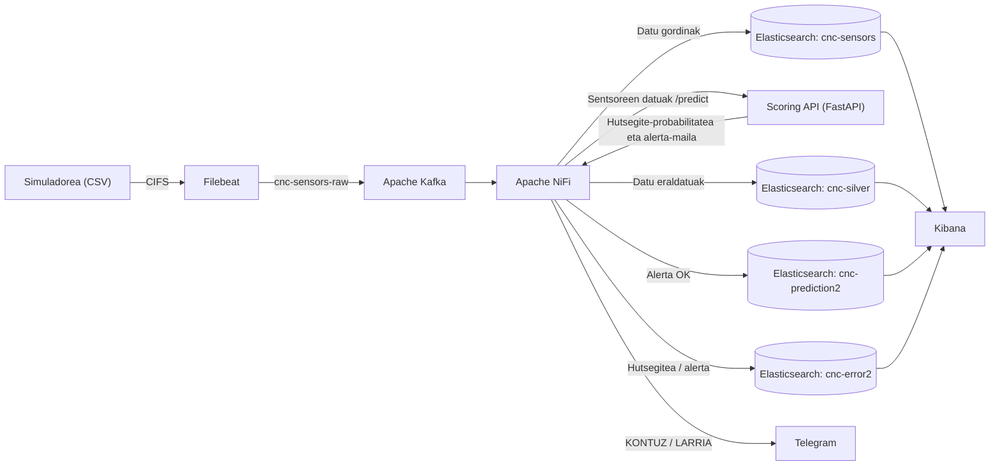

### 1.3. Azpiegitura edukiontziratua (Docker eta Docker Compose)
#### Docker Compose-ren helburua

> **Helburua:** Proiektuko zerbitzu guztiak modu isolatuan, errepikagarrian eta konfigurazio kontrolatuarekin exekutatzea.
CNC Guard proiektuan Docker eta Docker Compose erabili dira sistemaren azpiegitura osoa edukiontzien bidez hedatzeko eta kudeatzeko. Horri esker, proiektuko zerbitzu guztiak ingurune isolatu eta independenteetan exekuta daitezke, bakoitzaren mendekotasunak eta konfigurazioak kontrolatuz.

docker-compose.yml fitxategiak sistemaren zerbitzu guztiak definitzen ditu, baita haien arteko komunikazioa, sare-konfigurazioa, portuak, ingurune-aldagaiak, bolumen iraunkorrak eta abiarazte-mendekotasunak ere.

Konfiguratutako azpiegiturak honako zerbitzu hauek biltzen ditu:
| Zerbitzua | Erantzukizuna |
|---|---|
| Apache Kafka | Sentsoreen datuak bufferizatu eta streaming bidez banatzea. |
| Filebeat | Fitxategi partekatuko datuak irakurri eta Kafkara bidaltzea. |
| Apache NiFi | Datuen ingestioa, eraldaketa eta bideratze automatikoa. |
| Elasticsearch | Datuak eta aurreikuspenen emaitzak biltegiratzea eta indexatzea. |
| Kibana | Datuak bistaratzea eta monitorizazio-panelak sortzea. |
| Scoring API | Machine Learning ereduaren inferentziak eskaintzea FastAPI bidez. |

#### Filebeat — Fitxategien irakurketa eta bidalketa

Filebeat-ek fitxategi partekatuan sortzen diren sentsoreen datuak irakurtzen ditu eta konfiguratutako irteeraren bidez Kafkara bidaltzen ditu.

- `filebeat.yml`: irakurketa-iturburua, datuen iragazketa eta Kafka-rako konexioa definitzen ditu.
- `user: root`: fitxategi partekatuko edukia irakurtzeko beharrezko baimenak izatea ahalbidetzen du.
- `--strict.perms=false`: konfigurazio-fitxategiaren baimenei buruzko egiaztapen zorrotza desgaitzen du.
- `filebeat-data`: irakurritako fitxategien egoera eta aurrerapena gordetzen ditu, berrabiarazteetan prozesamendua kontrolatzeko.
- `cnc-stream-cifs`: CIFS bidez muntatutako fitxategi partekatua irakurtzeko erabiltzen da.

#### Apache NiFi — Datuen eraldaketa eta bideratzea

NiFi datuen streaming pipeline-aren koordinazioaz arduratzen da. Kafkatik jasotako mezuak prozesatu, beharrezko eraldaketak egin, Scoring APIarekin komunikatu eta emaitzak Elasticsearch-era bidaltzen ditu.

- `8443:8443`: NiFi-ren HTTPS web-interfazea eskuragarri jartzen du.
- `SINGLE_USER_CREDENTIALS_USERNAME` eta `SINGLE_USER_CREDENTIALS_PASSWORD`: web-interfazeko erabiltzailearen autentifikazioa konfiguratzen dute.
- `NIFI_WEB_HTTPS_PORT`: HTTPS bidezko sarbidearen portua definitzen du.
- `depends_on`: Kafka eta Elasticsearch zerbitzuak NiFi baino lehen abiaraztea ezartzen du.

#### Elasticsearch — Datuen biltegiratzea

Elasticsearch sistemaren biltegiratze eta bilaketa-motorra da. Sentsoreen erregistroak eta Machine Learning ereduak sortutako aurreikuspenak indexatzeko erabiltzen da.

- `discovery.type=single-node`: nodo bakarreko konfigurazioa erabiltzen du.
- `xpack.security.enabled=true`: autentifikazio- eta segurtasun-funtzioak aktibatzen ditu.
- `ELASTIC_PASSWORD`: administratzailearen pasahitza ezartzen du.
- `ES_JAVA_OPTS`: JVM-rako memoria-mugak definitzen ditu.
- `es-data`: datuen iraunkortasuna bermatzen du, edukiontzia berrabiarazi edo ordezkatu arren.

#### Kibana — Datuen bistaratzea

Kibanak Elasticsearch-en gordetako informazioa grafikoki aztertzeko aukera ematen du. Monitorizazio-panelak, KPIak, denbora-serieak, heatmap-ak eta gertaeren taulak sortzeko erabiltzen da.

- `ELASTICSEARCH_HOSTS`: Elasticsearch zerbitzuaren helbidea definitzen du.
- `ELASTICSEARCH_USERNAME`: Kibana-ren eta Elasticsearch-en arteko komunikaziorako erabiltzailea zehazten du.
- `ELASTICSEARCH_PASSWORD`: erabiltzaile horren pasahitza definitzen du.
- `XPACK_ENCRYPTEDSAVEDOBJECTS_ENCRYPTIONKEY`: Kibana-k objektu sentikorrak enkriptatzeko erabiltzen duen gakoa definitzen du.
- `5601:5601`: Kibana-ren web-interfazea eskuragarri jartzen du.

#### Scoring API — Machine Learning inferentzia

Scoring APIa FastAPI erabiliz garatutako mikrozerbitzua da. Aurretik entrenatutako Machine Learning eredua kargatzen du eta NiFIk bidalitako sentsoreen datuekin hutsegiteen probabilitatea kalkulatzen du.

- `build.context`: APIaren Docker irudia eraikitzeko erabiliko den direktorioa definitzen du.
- `8000:8000`: APIaren HTTP portua kanpora irekitzen du.
- `./models:/models:ro`: entrenatutako eredua edukiontzian muntatzen du, irakurtzeko soilik.
- `MODEL_PATH`: erabiliko den `.pkl` ereduaren kokapena definitzen du.
- `CORS_ORIGINS`: APIra konektatzeko baimendutako jatorriak zehazten ditu.
- `API_KEY_SECRET`: APIaren autentifikaziorako erabilitako gako sekretua definitzen du.

#### Bolumen iraunkorrak eta fitxategi partekatua
Docker-en bolumenak erabiltzen dira edukiontziak berrabiarazi arren beharrezko informazioa mantentzeko.

Proiektuan hiru bolumen nagusi definitu dira:

- `filebeat-data`: Filebeat-en egoera eta irakurketa-aurrerapena gordetzeko.
- `es-data`: Elasticsearch-en indexatutako informazioa gordetzeko.
- `cnc-stream-cifs`: sareko fitxategi partekatua CIFS protokoloaren bidez muntatzeko.

Azken bolumen horrek `192.168.75.150` zerbitzarian kokatutako `cnc-stream` direktorio partekatua erabiltzen du. `ro` aukerak irakurtzeko soilik muntatzen dela adierazten du.

#### Edukiontzien abiaraztea eta kudeaketa

**Zerbitzu guztiak batera abiarazteko:**
```bash
docker compose up -d --build
```

**Edukiontzien egoera ikusteko:**

```bash
docker compose ps
```

**Zerbitzu jakin baten log-ak ikusteko:**

```bash
docker compose logs -f kafka
```

**Zerbitzu guztiak gelditzeko:**

```bash
docker compose down
```
### 1.3.1. Ingurune-aldagaien konfigurazioa (`.env`)


Docker Compose-ren konfigurazioan kredentzialak eta informazio sentikorra zuzenean idatzi beharrean, ingurune-aldagaiak erabiltzen dira. Horretarako, `.env` fitxategia erabiltzen da.

Fitxategi horretan zerbitzuen konfigurazio pribatuak gordetzen dira, hala nola:

- NiFi-ren erabiltzaile-izena eta pasahitza.
- Elasticsearch-en administratzailearen pasahitza.
- Kibana-ren enkriptatze-gakoa.
- Scoring APIaren autentifikazio-gakoa.
- CIFS sare-partekatuaren erabiltzaile-izena eta pasahitza.

Docker Compose-k automatikoki irakurtzen ditu `.env` fitxategiko aldagaiak eta `docker-compose.yml` fitxategian `${ALDAGAIA}` sintaxiaren bidez erabiltzeko aukera ematen du.

#### `.env.example` fitxategia

Taldekide guztiek proiektua exekutatu ahal izateko, `.env.example` fitxategia gordeko da Git biltegian. Fitxategi horrek behar diren aldagai guztiak definituko ditu, baina benetako pasahitzik gabe.

Adibidez:

```env
# Apache NiFi
NIFI_USER=admin
NIFI_PASSWORD=CHANGE_ME_NIFI_PASSWORD

# Elasticsearch
ELASTIC_PASSWORD=CHANGE_ME_ELASTIC_PASSWORD

# Kibana
KIBANA_SYSTEM_PASSWORD=CHANGE_ME_KIBANA_PASSWORD
KIBANA_ENCRYPTION_KEY=CHANGE_ME_WITH_32_CHARACTERS_MINIMUM

# Scoring API
API_KEY_SECRET=CHANGE_ME_API_SECRET

# CIFS shared folder
CIFS_USERNAME=CHANGE_ME_CIFS_USER
CIFS_PASSWORD=CHANGE_ME_CIFS_PASSWORD
```
#### `.gitignore` fitxategia

Benetako `.env` fitxategia Git-etik kanpo utzi behar da, kredentzialak publikoki ez zabaltzeko.

Horretarako, .gitignore fitxategian honako lerro hauek gehituko dira:
```gitignore
# Environment variables and secrets
.env
.env.*
!.env.example
```

#### Taldekideen konfigurazioa

Taldekide bakoitzak bere `.env` fitxategia sortuko du `.env.example` fitxategitik abiatuta:
```bash
cp .env.example .env
```
Ondoren, dagokion ingurunean behar diren kredentzialak eta konfigurazio-balioak sartuko ditu.

Horrela, proiektuaren konfigurazio-egitura partekatzen da, baina kredentzial pertsonalak eta informazio sentikorra ez dira Git biltegian gordetzen.

**Garrantzitsua:** `.env.example` fitxategiak ez ditu benetako pasahitzak izan behar. Hala ere, zuen azpiegiturak CIFS partekatutako karpeta eta gainerako zerbitzuak behar dituenez, exekutatzeko benetako kredentzialak modu seguruan partekatu beharko dituzue, adibidez, kanal pribatu baten bidez.

### 1.4. Fitxategi partekatuaren konfigurazioa eta muntaketa (CIFS / NFS)

Windows eta Docker Desktop (WSL2) arteko ingurunean saretik datozen `.csv` fitxategiak denbora errealean eta baimen-arazorik gabe irakurri ahal izateko, montaje birtuala WSL2 bidez bideratu da.

Docker Desktop-en arkitektura dela eta, edukiontziek ezin dute zuzenean Windows-eko `N:\` sare-unitatea edo UNC bide-izenak (`\\192.168.75.150\...`) modu naturalean atzitu File Sharing baimen espliziturik gabe. Hori konpontzeko, Windows-eko `N:` unitatea WSL2-ren babespeko `/mnt/wsl/` direktorio globalean muntatu da `drvfs` kontrolatzailea erabiliz, edukiontzi guztientzat atzigarri egon dadin.

#### 1.4.1 WSL2 bidezko muntaketa komandoak (Host-ean)

Prozesua automatizatzeko edo eskuz egiteko exekutatutako komandoak:

```powershell
# 1. WSL2 barruan direktorio partekatua sortu
wsl -d Ubuntu -u root mkdir -p /mnt/wsl/cnc-stream

# 2. Windows-eko N: sare-unitatea drvfs bidez muntatu
wsl -d Ubuntu -u root mount -t drvfs 'N:' /mnt/wsl/cnc-stream

# 3. Fitxategiak denbora errealean iristen ari direla egiaztatu
wsl -d Ubuntu ls -la /mnt/wsl/cnc-stream
```
#### 1.4.2 Docker Compose bidezko bolumenaren mapaketa

docker-compose.yml fitxategian, Filebeat zerbitzuari WSL2ko bide-izen partekatu hori esleitu zaio:

```YAML
  filebeat:
    image: docker.elastic.co/beats/filebeat:8.11.0
    container_name: filebeat
    user: root
    command: ["filebeat", "-e", "-strict.perms=false"]
    volumes:
      - /mnt/wsl/cnc-stream:/mnt/cnc-stream:ro
      - ./filebeat/filebeat.yml:/usr/share/filebeat/filebeat.yml:ro
      - filebeat-data:/usr/share/filebeat/data
    depends_on:
      - kafka
```

#### Filebeat ingesta konfigurazioa (filebeat.yml)

Filebeat-ek sarrerako .csv fitxategi berriak detektatu eta Kafkako cnc-sensors-raw topikora bideratzeko konfigurazioa:

```YAML
# 1. SARRERA: irakaslearen karpetako CSVak
filebeat.inputs:
  - type: filestream
    id: cnc-stream
    paths:
      - /mnt/cnc-stream/*.csv
    exclude_lines: ['^timestamp']
    prospector.scanner.exclude_files: ['_00005\.csv$']
    prospector.scanner.fingerprint.enabled: false
    file_identity.path: ~
    close.on_state_change.inactive: 1m
# 2. IRTEERA: Kafka
output.kafka:
  hosts: ["kafka:9092"]
  topic: "cnc-sensors-raw"
  codec.format:
    string: '%{[message]}'
logging.level: info
logging.to_files: false
```

## 2. DATU-INGESTIOA ETA STREAMING AZPIEGITURA

### 2.1. Datuen jatorria eta sentsoreen formatua (CSV)

CNC Guard proiektuak **AI4I 2020 Predictive Maintenance Dataset** datu-multzoa erabiltzen du oinarri gisa. Datu-multzo horrek industria-ingurune bateko CNC makinen funtzionamendua eta sentsoreen neurketak simulatzen ditu, makinen hutsegiteak aurreikusteko eta mantentze prediktiboa lantzeko.

Datuak CSV (*Comma-Separated Values*) formatuan gordetzen dira. Fitxategi bakoitzaren lerro batek neurketa edo erregistro bat adierazten du, eta zutabe bakoitzak makinaren egoerari, funtzionamendu-parametroei edo hutsegiteei buruzko informazioa jasotzen du.

CSV fitxategiaren egitura honako hau da:

```text
timestamp,machine_id,machine_type,air_temp_K,process_temp_K,rpm,torque_Nm,tool_wear_min,machine_failure,failure_TWF,failure_HDF,failure_PWF,failure_OSF,failure_RNF
```

**Zutabeen deskribapena:**

| Zutabea | Deskribapena | Datu mota / Unitatea |
|---|---|---|
| `timestamp` | Neurketa egin den data eta ordua adierazten ditu. | Datetime (UTC) |
| `machine_id` | Neurketa egin duen makinaren identifikatzaile bakarra. | String |
| `machine_type` | Makinaren mota edo kategoria adierazten du (L, M edo H). | Kategorikoa |
| `air_temp_K` | Inguruko airearen tenperatura adierazten du. | Float (Kelvin) |
| `process_temp_K` | Makina-prozesuaren tenperatura adierazten du. | Float (Kelvin) |
| `rpm` | Makinaren biraketa-abiadura adierazten du. | Integer (RPM) |
| `torque_Nm` | Makinaren ardatzean aplikatutako momentu eragilea adierazten du. | Float (N·m) |
| `tool_wear_min` | Erremintak erabilitako denbora metatua adierazten du. | Integer (minutuak) |
| `machine_failure` | Makinak hutsegiterik izan duen adierazten du. | Boolean (0/1) |
| `failure_TWF` | Erremintaren higadurarekin lotutako hutsegitea (Tool Wear Failure). | Boolean (0/1) |
| `failure_HDF` | Beroaren disipazioarekin lotutako hutsegitea (Heat Dissipation Failure). | Boolean (0/1) |
| `failure_PWF` | Potentzia-prozesuarekin lotutako hutsegitea (Power Failure). | Boolean (0/1) |
| `failure_OSF` | Gehiegizko tentsio mekanikoarekin lotutako hutsegitea (Overstrain Failure). | Boolean (0/1) |
| `failure_RNF` | Ausazko hutsegitea (Random Failure). | Boolean (0/1) |

Hutsegiteen adierazleek balio bitarrak erabiltzen dituzte: `0` balioak hutsegiterik ez dagoela adierazten du, eta `1` balioak, berriz, dagokion hutsegite mota gertatu dela.

`machine_failure` aldagaia Machine Learning ereduaren **helburu-aldagaia (target variable)** da; hau da, ereduak makina baten hutsegitea gertatuko den aurreikusteko erabiltzen duen aldagaia. Gainerako `failure_*` zutabeek hutsegite mota zehazten dute, eta datuen azterketan eta ebaluazioan erabil daitezke.

Bestalde, `machine_id` eta `machine_type` aldagaiek makinak identifikatzeko eta sailkatzeko balio dute. Tenperatura, biraketa-abiadura, momentu eragilea eta erremintaren higadura, berriz, makinaren egoera operatiboa deskribatzen duten sentsore-ezaugarriak dira.

**Datuen prozesamenduan kontuan hartu beharreko alderdiak:**

- Tenperaturak Kelvin-etan jasotzen dira jatorrizko datuetan. Streaming pipeline-an Celsius graduetara bihurtzen dira, monitorizazioa eta interpretazioa errazteko.
- `rpm`, `torque_Nm` eta `tool_wear_min` aldagaiek makinaren egoera mekanikoa eta erabilera-maila deskribatzen dituzte.
- `machine_type` aldagai kategorikoa da, eta entrenamendu-fasean kodetu behar da ereduak erabil dezan.
- Hutsegiteen adierazleak datu historikoen analisirako erabiltzen dira. Inferentzia-fasean, ordea, ereduak sentsoreen neurketetatik abiatuta kalkulatzen du hutsegitearen probabilitatea.
- Datuen ingestioan, erregistro bakoitzaren denbora-zigilua eta makinaren identifikatzailea mantentzen dira, ondorengo monitorizazioa eta trazabilitatea bermatzeko.

CSV formatua aukeratu da datuak modu sinple eta egituratuan gordetzeko, baita Filebeat, Apache Kafka eta Apache NiFi bezalako tresnekin erraz integratzeko ere.

### 2.2. Filebeat: konfigurazioa, iragazketa eta egoeraren erregistrua
Proiektu honetan, Filebeat datuak biltzeko eragile arin gisa (lightweight shipper) erabiltzen da. Bere eginkizun nagusia sentsoreek sortutako CSV fitxategiak irakurtzea eta, ia denbora errealean, Apache Kafkara bidaltzea da, datuen prozesamendu-fluxuarekin jarraitzeko.
#### Sarreren Konfigurazioa eta Iragazketa (Inputs)

- **Datu-iturburua:** Filebeat-ek `filestream` motako sarrera erabiltzen du. Karpeta espezifiko bat monitorizatzen du, zehazki `/mnt/cnc-stream/*.csv` bidean dauden fitxategi guztiak irakurriz.
- **Goiburukoen iragazketa:** CSV fitxategien lehen lerroa (goiburukoa) ez prozesatzeko, `exclude_lines: ['^timestamp']` parametroa aplikatzen da, "timestamp" hitzarekin hasten diren lerroak baztertuz.
- **Fitxategi zehatzen bazterketa:** Segurtasun edo prozesamendu-logikako arrazoiengatik, zenbait fitxategi baztertzen dira, hala nola `_00005.csv` amaiera dutenak (`prospector.scanner.exclude_files: ['_00005\.csv$']`).
- **Egoeraren kudeaketa:** Fitxategi inaktiboak modu eraginkorrean kudeatzeko, 1 minutu baino gehiago inaktibo egon diren fitxategiak ixteko agintzen zaio Filebeat-i (`close.on_state_change.inactive: 1m`). Gainera, hatz-marka bidezko jarraipena eta fitxategi-identitate estandarra desgaituta daude konfigurazio honetan.

#### Irteeraren Konfigurazioa (Output)

- **Helmugako Broker-a:** Datu garbiak Apache Kafkara bidaltzen dira zuzenean, `kafka:9092` ostalaria helburu hartuta.
- **Topic-a eta Formatua:** Mezuak `cnc-sensors-raw` gaian (topic) idazten dira. Payload-a formatu garbian bidaltzeko, mezuaren edukia zuzenean testu gisa (`string: '%{[message]}'`) kodetzen duen kodeketa (codec) erabiltzen da.

#### Docker Integrazioa, Bolumenak eta Erregistroa

- **Inplementazioa eta Baimenak:** `docker.elastic.co/beats/filebeat:8.11.1` irudia exekutatzen da. Sistemaren baimenekin sor daitezkeen gatazkak ekiditeko, edukiontzia `root` erabiltzaile gisa abiatzen da. Exekuzio-komandoari `--strict.perms=false` gehitzen zaio konfigurazio-fitxategiaren irakurketa ahalbidetzeko baimen estriktuak ezarri gabe.
- **Kanpoko Datu-sarrera (CIFS):** Sentsoreen datuak sareko direktorio partekatu batetik eskuratzen dira. Horretarako, `cnc-stream-cifs` izeneko bolumena konfiguratzen da CIFS protokoloaren bidez, sareko `//192.168.75.150/cnc-stream` jatorria irakurketa-soileko (`ro`) moduan mapatuz `cncuser` kredentzialen bidez. Bolumen hau edukiontziaren `/mnt/cnc-stream` barne-bidean muntatzen da.
- **Egoeraren Erregistroa (Registry):** Filebeat-ek fitxategi bakoitzean nora arte irakurri duen (offset-a) gogoratu dezan berrabiarazte bat gertatuko balitz, `filebeat-data` izeneko bolumen iraunkor bat muntatzen da `/usr/share/filebeat/data` bidean. Horrela bermatzen da daturik ez dela bikoizten eta bat bera ere ez dela galtzen.

### 2.3. Apache Kafka: broker-a, topic-ak (`cnc-sensors-raw`), partizioak eta kontsumitzaile-taldeak
Proiektu honetan, Apache Kafka datuen ingestio-fluxuaren ardatz nagusia edo *broker*-a da. Bere funtzio nagusia sentsoreen datu gordinak denbora errealean jasotzea eta prozesamendu-sistemek (Apache NiFi) kontsumitu ditzaten eskuragarri jartzea da.

Datuen jarioa honela egituratzen da Kafkaren inguruan:

- **Datuen sarrera (Filebeat):** Filebeat tresna konfiguratuta dago sentsoreen CSV datuak irakurri eta Kafkako `cnc-sensors-raw` izeneko *topic*-era bidaltzeko.
- **Datuen irteera (NiFi):** Apache NiFi-k `ConsumeKafka` prozesadorea erabiltzen du topic horretatik datuak irakurtzeko. Irakurketa `cnc-nifi` kontsumitzaile-taldearen (*Group ID*) bidez egiten da. Kontsumitzaile-taldeak mezuen kontsumoa koordinatzen du eta irakurritako offset-ak kudeatzen ditu. Kafka-k mezuen ordena partizio bakoitzaren barruan mantentzen du; beraz, partizio desberdinetako mezuen arteko ordena globala ez dago bermatuta.

#### Topic-aren sorrera

Sentsoreen informazioa bideratzeko `cnc-sensors-raw` *topic*-a sortu behar da. Egitura honetan 3 partizio definitu dira datuen irakurketa paraleloa ahalbidetzeko, eta erreplikazio-faktorea 1 gisa utzi da, nodo bakarreko kluster batean baikaude.

Horretarako, honako komando hau exekutatu dugu terminalean (Docker edukiontziaren kanpotik):

```bash
# Terminala abiarazi
docker exec -it cnc-kafka bash
```

```bash
kafka-topics --create --topic cnc-sensors-raw --partitions 3 --replication-factor 1 --bootstrap-server localhost:9092
```

#### Konfigurazioaren egiaztapena
Topic-a behar bezala sortu dela eta partizio nahiz erreplikazio datuak zuzenak direla egiaztatzeko, describe komandoa erabili da:
```bash
kafka-topics --describe --topic cnc-sensors-raw --bootstrap-server localhost:9092
```
Komando honek topic-aren egoera orokorra eta partizio bakoitzaren nodo liderra zein den erakusten du, dena prest dagoela ziurtatuz ingestioarekin hasteko.

### 2.4. Apache NiFi: Datuen Ingestioa, Streaming-a eta Controller Service-ak

Proiektu honetan Apache NiFi erabili dugu datuen fluxu osoa kudeatzeko, sentsoreetatik Elasticsearch-era eta Machine Learning eredura bideratuz. Bi fluxu nagusi diseinatu dira (1. fasea eta 3. fasea), baina **3. faseko fluxuak 1. faseko ingestio-prozesu bera biltzen du bere baitan**.

Jarraian, prozesu osoaren arkitektura, osagaiak eta konfigurazioak zehazten dira.

#### 1. Ingestio-fluxuaren oinarria (1. Fasea)

3. faseko fluxuaren lehen zatia hasierako ingestio-fluxuaren (*fase1_ingest.json*) kopia zehatza da. Helburua Kafkatik datu gordinak irakurri eta Elasticsearch-en gordetzea da.

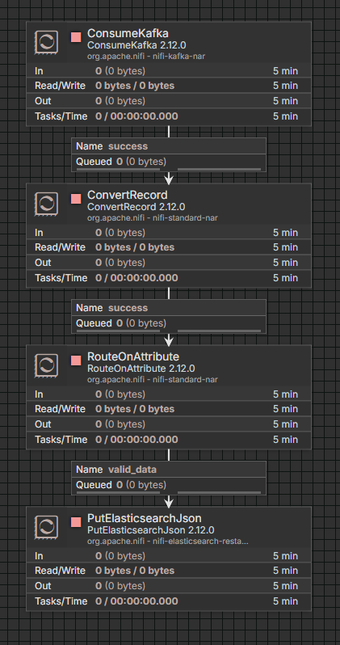

Urrats eta prozesadore hauek jarraitzen ditu:

- **`ConsumeKafka`:** Kafkako `cnc-sensors-raw` *topic*-era harpidetzen da datuak denbora errealean jasotzeko.
- **`ConvertRecord`:** Kafkatik jasotako CSV formatuko datuak JSON formatura bihurtzen ditu, prozesamendua errazteko.
- **`RouteOnAttribute`:** Iragazki sinple bat aplikatzen du datu hutsak edo baliogabeak baztertzeko (`${fileSize:gt(0)}` baldintzarekin).
- **`PutElasticsearchJson`:** Datu gordinak (*raw*) Elasticsearch-eko `cnc-sensors` indizean gordetzen ditu zuzenean, geroago aztertu ahal izateko.

#### 2. Streaming eta Iragarpen Fluxu Aurreratua (3. Fasea)

Behin datu gordinak prozesatuta, fluxuak bide berri bat irekitzen du datu horiek denbora errealean Machine Learning API-ra bidaltzeko eta emaitzen arabera ekintzak burutzeko (*fase3_streaming.json*).

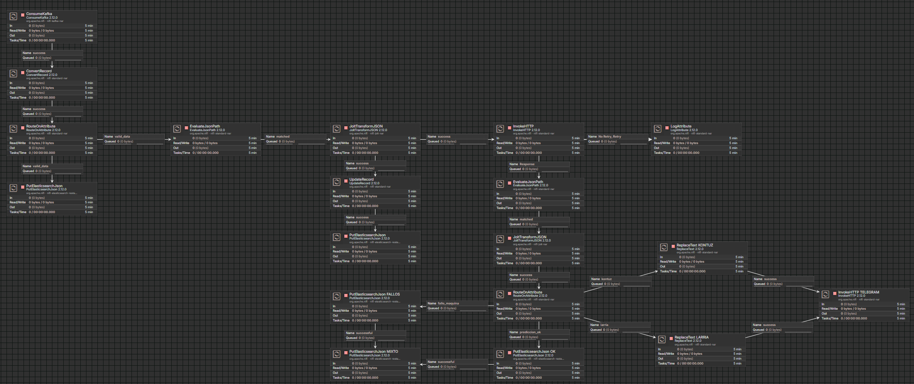

Fase honetako prozesadore nagusiak lau multzotan banatzen dira:

**A) Datuen prestaketa API-rako**

- **`EvaluateJsonPath`:** Datuen fluxutik beharrezko eremuak ateratzen ditu (`machine_id`, `machine_type`, `timestamp`) eta NiFi atributu gisa gordetzen ditu memorian.
- **`JoltTransformJSON`:** JSON mezuaren egitura eraldatzen du (Jolt espezifikazioen bidez), Scoring API-ak (FastAPI) eskatzen duen sarrera-formatu zehatzera egokituz.

**B) Machine Learning ereduari deia**

- **`InvokeHTTP` (Scoring API):** API-ari `POST` eskaera bat egiten dio datuekin (`http://scoring-api:8000/predict`). Segurtasunerako `X-API-Key` bat bidaltzen du goiburukoan, baimenik gabeko sarbideak ekiditeko.
- **`EvaluateJsonPath`:** API-ak itzultzen duen JSON erantzunetik iragarpenaren emaitzak erauzten ditu: `failure_predicted`, `failure_probability` eta `alert_level`.

**C) Bideratzea eta biltegiratzea (emaitzen arabera)**

Iragarpenaren emaitza aztertu ondoren, **`RouteOnAttribute`** prozesadore baten bidez fluxua hainbat adarretan banatzen da (APIak itzulitako alerta-mailaren arabera: OK, KONTUZ, LARRIA):

- **`PutElasticsearchJson OK`:** Makinak ondo funtzionatzen badu, datuak `cnc-prediction2` indizean gordetzen dira.
- **`PutElasticsearchJson FALLOS`:** Makinan anomalia bat aurreikusten bada (KONTUZ edo LARRIA), informazioa `cnc-error2` indize bereizian gordetzen da.
- **`UpdateRecord` & `PutElasticsearchJson (Silver)`:** Paraleloki, tenperaturak Kelvinetik Celsius gradutara eraldatzen dira `UpdateRecord` erabiliz, eta datu garbiago horiek `cnc-silver` indizean gordetzen dira, gerora analisi historikoa egiteko.

**D) Alerta-sistema (Telegram)**

API-ak makina baten hutsegite arriskua detektatzen badu, denbora errealeko abisuak bidaltzen dira mantentze-taldeko Telegram kanalera:

- **`ReplaceText KONTUZ` / `LARRIA`:** Iragarritako alerta-mailaren arabera, Telegramerako mezu formatu berezi bat (Markdown) sortzen du, makinaren ID-a, data eta egoera txertatuz.
- **`InvokeHTTP TELEGRAM`:** Telegramen API ofizialera deitzen du bot baten bidez (`/sendMessage`), abisua mantentze-taldearen txatean berehala ager dadin.

#### 3. Controller Services (Atzeko planoko zerbitzuak)

Fluxu hauek behar bezala exekutatu daitezen, NiFi-n ezinbestekoak diren zenbait *Controller Service* konfiguratu dira:

- **`Kafka3ConnectionService`:** Kafkarekin (`kafka:9092`) konexio seguru eta egonkorra mantentzeaz arduratzen da.
- **`CSVReader` eta `JsonRecordSetWriter`:** `ConvertRecord` prozesadoreak erabiltzen ditu sarrerako datuak CSV gisa interpretatzeko eta irteera JSON formatu egituratuan idazteko.
- **`ElasticSearchClientServiceImpl`:** Elasticsearch-erako konexio zentralizatua kudeatzen du (`http://elasticsearch:9200`), prozesadore guztiek konexio bera partekatu dezaten, baliabideak optimizatuz.

## 3. DATUEN AZTERKETA ESPLORATZAILEA (EDA) ETA AURREPROZESATZEA

### 3.1. Entrenamendu-datasetaren azterketa (`ai4i2020_train.csv`)
Lehenik, AI4I 2020 datu-multzoaren entrenamendurako zatia kargatu da, `pandas` liburutegia erabiliz. Hasierako azterketaren helburua datuen egitura ezagutzea izan da: erregistro eta zutabe kopurua, datu motak, estatistika deskribatzaileak, balio faltak eta helburu-aldagaiaren banaketa.

Horretarako, `info()`, `describe()` eta `isnull().sum()` metodoak erabili dira, baita `machine_failure` aldagaiaren maiztasunak eta proportzioak aztertzeko `value_counts()` ere.

```python
import pandas as pd

df = pd.read_csv("../data/ai4i2020_train.csv")

# Datu-multzoaren egitura eta datu motak
df.info()

# Estatistika deskribatzaileak
display(df.describe())

# Balio faltak aztertu
display(df.isnull().sum())

# Helburu-aldagaiaren banaketa
print(df["machine_failure"].value_counts())
print(df["machine_failure"].value_counts(normalize=True) * 100)
```
Azterketaren arabera, entrenamendu-datasetak 8.000 erregistro eta 13 zutabe ditu. Ez da balio faltarik aurkitu, beraz, ez da beharrezkoa izan hasierako fase honetan falta diren datuak ezabatu edo ordezkatzea.

Helburu-aldagaiaren (machine_failure) banaketak, ordea, desoreka nabarmena erakusten du:
- Hutsegiterik gabeko erregistroak: %96,6 inguru.
- Hutsegitea duten erregistroak: %3,4 inguru.
Banaketa horrek esan nahi du hutsegiteak gutxiengo-klasea direla. Egoera horretan, eredu batek erregistro gehienak zuzen sailka ditzake hutsegiteak ia inoiz detektatu gabe ere. Horregatik, accuracy metrika bakarrik erabiltzea ez da egokia ereduaren benetako kalitatea ebaluatzeko.

Proiektuaren helburu nagusia makinen hutsegiteak garaiz detektatzea denez, arreta berezia jarri zaie recall, precision eta F1-score metrikek ematen duten informazioari. Bereziki garrantzitsua da benetako hutsegiteak identifikatzea, detektatu gabeko hutsegite batek makina gelditzea eta ekoizpen-galerak eragin baititzake.

### 3.2. Azterketa esploratzailea (EDA) eta datu-banaketak
Datasetaren egitura orokorra aztertu ondoren, azterketa esploratzaile grafikoa (EDA) egin da sentsoreen portaera eta aldagaien arteko erlazioak hobeto ulertzeko.

Horretarako, hainbat irudikapen grafiko erabili dira:
- Banaketa-histogramak: Tenperatura, biraketa-abiadura, momentua eta erremintaren higadura bezalako sentsore-aldagaien banaketa aztertzeko. Hutsegiteak eta hutsegiterik gabeko erregistroak bereizita aztertzeak klaseen arteko desberdintasun posibleak identifikatzen laguntzen du.
- Hutsegite-moten azterketa: Hutsegite mota bakoitzaren maiztasuna aztertzeko (failure_TWF, failure_HDF, failure_PWF, failure_OSF eta failure_RNF).
- Korrelazio-matrizea: Aldagai numerikoen arteko erlazio linealak eta helburu-aldagaiarekiko loturak aztertzeko.
- Pairplot grafikoak: Sentsoreen arteko erlazioak modu bateratuan ikusteko eta hutsegiteak dituzten erregistroek banaketa desberdina duten aztertzeko.
- Boxplot grafikoak: Aldagai numerikoen sakabanaketa eta balio muturreko posibleak (outliers) identifikatzeko.
- Makinen erregistro-kopurua: Makina bakoitzak datasetaren barruan duen erregistro-kopurua aztertzeko.
Analisi grafiko horiek lagungarriak izan dira datuen portaera ulertzeko eta sentsoreen arteko erlazio posibleak identifikatzeko. Bereziki, tenperaturaren, momentuaren eta erremintaren higaduraren arteko konbinazioek hutsegiteen detekzioan izan dezaketen garrantzia aztertu da.

Boxploten bidez balio muturrekoak ere aztertu dira. Hala ere, industria-ingurune batean balio muturreko guztiak ez dira automatikoki erroreak: sentsore batek ohikoa ez den neurketa bat jasotzea makinaren egoera anormal baten seinale izan daiteke. Horregatik, ez dira balio horiek automatikoki ezabatu; haien izaera eta esanahi fisikoa kontuan hartu dira.

EDAren emaitzek aurreprozesatze-estrategia definitzeko eta ereduari eman beharreko ezaugarriak aukeratzeko oinarria eskaini dute.

### 3.3. Datuen garbiketa eta datu-ihesaren (data leakage) prebentzioa
Ereduak benetako ekoizpen-ingurune batean izango lukeen informazio bera erabil dezan, aurreprozesatzean datu-ihesa (data leakage) saihestea ezinbestekoa izan da.

AI4I 2020 datasetak hutsegite mota bakoitzari buruzko informazioa jasotzen duten hainbat zutabe ditu. Zutabe horiek hutsegitea gertatu ondoren edo diagnostikatu ondoren ezagutzen den informazioa adierazten dute. Beraz, ereduaren sarrera gisa erabiliz gero, ereduak etorkizuneko edo helburuaren ondoriozko informazioa izango luke eskura, eta horrek ebaluazioaren emaitzak artifizialki hobetuko lituzke.

Horregatik, honako zutabe hauek ezabatu dira:
- failure_TWF
- failure_HDF
- failure_PWF
- failure_OSF
- failure_RNF
machine_id zutabea ere kendu da. Identifikatzaile hutsa denez, ez du makinaren egoera fisikoari buruzko informaziorik ematen. Gainera, ereduak makina jakin baten identifikatzailea ikastea saihestu nahi da, sentsoreen benetako portaeran oinarritutako iragarpenak egin ditzan.

machine_failure aldagaia, aldiz, mantendu egin da, ereduaren helburu-aldagaia baita. Ezaugarri prediktiboen artean ez sartzea bermatu da.

```python
drop_cols = [
    "machine_id",
    "failure_TWF",
    "failure_HDF",
    "failure_PWF",
    "failure_OSF",
    "failure_RNF",
]

df_clean = df.drop(columns=drop_cols)
```

Garbiketa honen bidez, ereduak hutsegitea aurreikusteko benetako erabileran eskuragarri egongo liratekeen sentsore-neurketak eta makina motaren informazioa erabiltzen ditu, hutsegitearen ondoriozko informaziorik gabe.
### 3.4. Kategoria-aldagaien kodetzea (One-Hot Encoding)
Datasetak machine_type izeneko kategoria-aldagaia dauka, hiru makina mota adierazten dituena: H, L eta M.

Machine Learning algoritmoek ezin dituzte kategoria horiek testu gisa zuzenean prozesatu. Horregatik, One-Hot Encoding teknika erabili da, kategoria bakoitza zenbakizko adierazle bitar batean bihurtzeko.

```python
df_encoded = pd.get_dummies(
    df_clean,
    columns=["machine_type"],
    drop_first=True,
    dtype=int,
)
```
drop_first=True parametroaren bidez, lehenengo kategoria erreferentzia gisa mantentzen da, eta ez da haren zutabe espezifikorik sortzen. Kasu honetan, H kategoria erreferentzia da, eta honako bi zutabeak sortzen dira:
- machine_type_L: 1 izango da makina mota L denean; bestela, 0.
- machine_type_M: 1 izango da makina mota M denean; bestela, 0.
H motako makinen kasuan, bi adierazleek 0 balioa izango dute.

Teknika honen bidez, kategorien informazioa zenbakizko formatuan adierazten da, haien artean existitzen ez den ordena erlazionalik ezarri gabe. Horrela, ereduak makina motaren eragina ikas dezake kategoria bakoitzari balio ordinal faltsurik eman gabe.

### 3.5. Ezaugarri eratorrien sorrera (Feature Engineering)
Sentsoreen jatorrizko neurketek informazio baliagarria eskaintzen dute, baina aldagai horien arteko erlazioek ere informazio prediktibo gehigarria eman dezakete. Horregatik, Feature Engineering teknika erabili da, jatorrizko ezaugarrietatik abiatuta hiru aldagai eratorri sortzeko.

Ezaugarri berriak domeinu-ezagutzan eta makinen funtzionamendu fisikoan oinarrituta aukeratu dira.

```python
# Potentziaren estimazioa
df_encoded["power"] = (
    df_encoded["rpm"] * df_encoded["torque_Nm"]
)

# Prozesuko eta giroko tenperaturen arteko diferentzia
df_encoded["temp_diff"] = (
    df_encoded["process_temp_K"] - df_encoded["air_temp_K"]
)

# Momentuaren eta erremintaren higaduraren arteko biderketa
df_encoded["torque_wear"] = (
    df_encoded["torque_Nm"] * df_encoded["tool_wear_min"]
)
```
Sortutako hiru ezaugarriak honako hauek dira:
| Parametroa | Balioa | Azalpena |
|---|---|---|
| `power` | `rpm * torque_Nm` | Biraketa-abiaduraren eta momentuaren arteko erlazioa adieraztea, makinaren lan-intentsitateari buruzko informazioa emanez. |
| `temp_diff` | `process_temp_K - air_temp_K` | Prozesuko eta giroko tenperaturen arteko diferentzia neurtzea, beroketa-maila aztertzeko. |
| `torque_wear` | `torque_Nm * tool_wear_min` | Momentuaren eta erremintaren higaduraren arteko elkarrekintza adieraztea, higadurak lan-kargarekin duen erlazioa aztertzeko. |

Ezaugarri eratorri horien helburua ez da jatorrizko sentsore-neurketak ordezkatzea, baizik eta haien arteko erlazioak adieraztea eta ereduari informazio prediktibo gehigarria eskaintzea.

Ezaugarri horiek domeinu-ezagutzan oinarrituta sortu dira. Hala ere, haien erabilgarritasuna ereduaren ebaluazioaren bidez egiaztatu behar da, ezaugarri berriak gehitzeak ez baitu berez errendimendua hobetzea bermatzen.

**Oharra:** `power` aldagaia `rpm * torque_Nm` kalkulua potentziaren adierazle proportzional gisa erabiltzen da. Ez da potentzia fisikoaren neurketa zuzena wattetan (W).

## 4. MACHINE LEARNING EREDUAREN ENTRENAMENDUA ETA EBALUAZIOA

### 4.1. Entrenamendu- eta balidazio-multzoen banaketa estrategikoa
Aurreprozesatzea amaitu ondoren, ereduak erabiliko dituen ezaugarriak (`X`) eta aurreikusi beharreko helburu-aldagaia (`y`) banandu dira.

Ereduak guztira hamar ezaugarri erabiltzen ditu:

- Bost jatorrizko sentsore-ezaugarri: `air_temp_K`, `process_temp_K`, `rpm`, `torque_Nm` eta `tool_wear_min`.
- Hiru ezaugarri eratorri: `power`, `temp_diff` eta `torque_wear`.
- Bi makina motaren adierazle: `machine_type_L` eta `machine_type_M`.

Ezaugarrien ordena esplizituki definitu da, entrenamenduan eta ondorengo predikzioetan beti sarrera-egitura bera erabiltzeko.

```python
FEATURES = [
    "air_temp_K",
    "process_temp_K",
    "rpm",
    "torque_Nm",
    "tool_wear_min",
    "power",
    "temp_diff",
    "torque_wear",
    "machine_type_L",
    "machine_type_M",
]

X = df_encoded[FEATURES]
y = df_encoded["machine_failure"]
```
Ondoren, datu-multzoa entrenamendu- eta balidazio-multzoetan banatu da, train_test_split() funtzioaren bidez.
```python
from sklearn.model_selection import train_test_split

X_train, X_val, y_train, y_val = train_test_split(
    X,
    y,
    test_size=0.20,
    random_state=42,
    stratify=y,
)
```
Banaketa honela egin da:
- %80 entrenamendurako: ereduak sentsoreen datuetatik hutsegiteen portaera ikasteko erabiltzen den zatia.
- %20 balidaziorako: entrenatutako ereduaren portaera aurrez ikusi gabeko datuekin ebaluatzeko erabiltzen den zatia.
random_state=42 parametroa erabili da banaketa errepikagarria izan dadin. Horrela, kodea berriro exekutatzean entrenamendu- eta balidazio-multzo berdinak lortzen dira.

Bestalde, stratify=y parametroa bereziki garrantzitsua da proiektu honetan, hasierako datu-multzoa oso desorekatuta dagoelako. Estratifikazioaren bidez, hutsegiteen eta hutsegiterik gabeko erregistroen proportzioa mantentzen da bi multzoetan. Horrela, balidazio-multzoak benetako datuen banaketa ordezkatzen jarraitzen du, gutxiengo-klaseko erregistro gehiegi galdu edo pilatu gabe.

Banaketa honi esker, ereduaren entrenamendua eta haren ebaluazioa bereizita egiten dira, eta balidazio-datuak ez dira ereduak ikasteko erabiltzen.

### 4.2. Klase-desoreka tratatzeko estrategiak (Class Weight eta SMOTE)
Hasierako EDA azterketan ikusi den bezala, machine_failure helburu-aldagaia oso desorekatuta dago: hutsegiteak erregistro guztien %3,4 inguru baino ez dira.

Desoreka hori tratatu gabe utziz gero, ereduak klase nagusiari gehiegizko garrantzia emateko joera izan dezake. Horren ondorioz, hutsegiterik gabeko kasuak zuzen sailkatuko lituzke gehienetan, baina benetako hutsegite asko detektatu gabe utz ditzake.

Arazo hori murrizteko, bi estrategia nagusi aztertu dira: class_weight eta SMOTE.

#### A) Class Weight

Lehenengo estrategian, RandomForestClassifier algoritmoaren class_weight="balanced" parametroa erabili da.
```python
from sklearn.ensemble import RandomForestClassifier

model = RandomForestClassifier(
    n_estimators=2000,
    max_depth=15,
    min_samples_split=4,
    class_weight="balanced",
    random_state=42,
)
```
Parametro horrek klase bakoitzari pisu desberdina esleitzen dio, klase bakoitzaren maiztasunaren arabera. Gutxiengo-klasea denez, hutsegiteen erregistroek pisu handiagoa jasotzen dute entrenamenduan.

Estrategia honen abantaila nagusia da jatorrizko datuen banaketa mantentzen duela, lagin artifizialik sortu gabe. Gainera, algoritmoaren barruan aplikatzen denez, ez du datu-multzoaren tamaina handitzen.

Bigarren estrategian, SMOTE teknika aztertu da. Teknika honek gutxiengo-klaseko lagin sintetikoak sortzen ditu, klaseen arteko desoreka murrizteko.

Horretarako, imblearn liburutegiko SMOTE eta Pipeline erabili dira.
```python
from imblearn.over_sampling import SMOTE
from imblearn.pipeline import Pipeline as ImbPipeline

from sklearn.ensemble import RandomForestClassifier
from sklearn.model_selection import cross_validate

smote_model = ImbPipeline([
    ("smote", SMOTE(random_state=42)),
    ("classifier", RandomForestClassifier(
        n_estimators=2000,
        max_depth=15,
        min_samples_split=4,
        class_weight=None,
        random_state=42,
    )),
])

smote_results = cross_validate(
    smote_model,
    X_train,
    y_train,
    cv=skf,
    scoring=scoring,
    n_jobs=-1,
)
```
SMOTE pipeline baten barruan integratzea erabaki garrantzitsua da. Horrela, balidazio gurutzatuan lagin sintetikoak entrenamendurako erabiltzen diren zatietan bakarrik sortzen dira. Balidazio-zatiak jatorrizko datuekin mantentzen dira, datu-ihesa saihesteko eta ebaluazio fidagarriagoa lortzeko.

Bi estrategiak alderatuz, class_weight aukerak jatorrizko datuen egitura mantentzen du; SMOTE estrategiak, berriz, gutxiengo-klasearen ordezkaritza handitzen du lagin sintetikoen bidez. Horregatik, bi ikuspegiak aztertu dira, hutsegiteen detekzioan zein den eraginkorragoa zehazteko.
#### Bi estrategien arteko aukeraketa eta justifikazioa

Bi estrategiak probatu ondoren, azken sistemarako `class_weight="balanced"` konfigurazioa duen Random Forest eredua aukeratu da, balidazio-multzoan emaitza hobeak lortu dituelako.

Bi estrategien arteko konparazioa egiteko, eredu bakoitza balidazio-multzo berarekin ebaluatu da, eta biei 0,40ko erabaki-atalase bera aplikatu zaie. Horrela, emaitzak baldintza berdinetan alderatu ahal izan dira.

Emaitzek honako hau erakusten dute:

| Metrika | Random Forest (`class_weight`) | Random Forest + SMOTE |
|---|---:|---:|
| Precision | 0,8148 | 0,6027 |
| Recall | 0,8148 | 0,8148 |
| F1-score | 0,8148 | 0,6929 |
| ROC-AUC | 0,9792 | 0,9696 |

Emaitzak aztertuta, bi ereduek Recall balio bera lortu dute (0,8148). Horrek esan nahi du bi estrategiek benetako hutsegiteen %81,48 detektatu dituztela. Hala ere, Precision metrikak alde nabarmena erakusten du: `class_weight` erabiliz, hutsegite gisa iragarritako kasuen %81,48 benetako hutsegiteak dira; SMOTE erabiliz, berriz, %60,27 baino ez.

Horrek esan nahi du SMOTE bidezko ereduak alarma faltsu gehiago sortzen dituela, benetako hutsegite kopuru bera detektatuta. CNC Guard sisteman, alarma faltsuek mantentze-lanen alferrikako egiaztapenak eta baliabideen erabilera gehigarria eragin ditzakete. Bestalde, benetako hutsegite bat detektatu gabe uzteak geldialdi operatiboak eta kostu ekonomikoak sor ditzake.

Beraz, bi estrategien artean `class_weight="balanced"` aukeratu da, hutsegiteak detektatzeko gaitasuna mantentzen duelako eta, aldi berean, alarma faltsu gutxiago sortzen dituelako. Gainera, estrategia horrek jatorrizko datuen banaketa mantentzen du, lagin sintetikoak sortu gabe.

Horrenbestez, SMOTE ez da baztertu emaitza txarrak dituen teknika delako, baizik eta egindako esperimentuan ez duelako azken sistemarako `class_weight` estrategiak baino emaitza hoberik eskaini. Azken erabakia proiektuaren helburu operatiboarekin eta balidazio-emaitzekin bat dator.

### 4.3. Algoritmoen entrenamendua: Random Forest vs XGBoost
Hutsegiteak aurreikusteko bi algoritmo nagusi aztertu dira: Random Forest eta XGBoost. Horrez gain, Random Forest eta SMOTE konbinatzen dituen hirugarren estrategia ere ebaluatu da.

#### Algoritmoak aukeratzeko irizpideak

CNC Guard proiektuan sailkapen-problema bat ebatzi behar da: sentsoreen neurketak aztertuta, makina batek hutsegiterik izango duen edo ez aurreikustea. Horretarako, ikaskuntza gainbegiratuko sailkapen-algoritmoak aztertu dira, helburu-aldagaiak (`machine_failure`) bi klase baititu: `0` (hutsegiterik ez) eta `1` (hutsegitea).

Algoritmo bat aukeratzerakoan, ez da kontuan hartu soilik sailkapenaren zehaztasuna. Beste alderdi hauek ere hartu dira kontuan:

- **Datuen portaera:** sentsoreen aldagaien arteko erlazioak konplexuak izan daitezke, eta ez dute zertan linealak izan.
- **Klase-desoreka:** hutsegiteak erregistro guztien %3,4 inguru baino ez dira; beraz, gutxiengo-klasea behar bezala identifikatzeko gaitasuna garrantzitsua da.
- **Hutsegiteen detekzioa:** bereziki garrantzitsua da Recall metrika, benetako hutsegiteak detektatu gabe uzteak ondorio ekonomikoak eta operatiboak izan baititzake.
- **Ereduaren erabilgarritasuna:** entrenatutako eredua FastAPI bidezko inferentzia-zerbitzuan integratu behar da, denbora errealeko datuak sailkatzeko.

##### Sailkapen-algoritmoen familia nagusiak

Sailkapen-problemak ebazteko hainbat algoritmo-familia erabil daitezke:

| Algoritmo mota | Funtzionamendua | CNC Guard proiektuan |
|---|---|---|
| Metodo linealak (adibidez, Logistic Regression) | Ezaugarrien eta helburu-aldagaiaren arteko erlazio lineala modelatzen dute, hutsegite-probabilitatea kalkulatzeko. | Oinarrizko erreferentzia gisa erabil daitezke, baina baliteke sentsoreen arteko erlazio konplexuak behar bezala ez modelatzea. |
| Bagging (adibidez, Random Forest) | Eredu independente batzuk entrenatzen ditu datu-lagin desberdinekin, eta haien emaitzak konbinatzen ditu. | Egokia da ezaugarrien arteko erlazio konplexuak modelatzeko eta predikzio egonkorragoak lortzeko. |
| Boosting (adibidez, XGBoost) | Ereduak sekuentzialki entrenatzen ditu, aurreko ereduek egindako erroreak zuzentzen saiatuz. | Datuetan eredu konplexuak aurkitzeko eta sailkapen-errendimendua hobetzeko erabil daiteke. |

Metodo linealen aldean, zuhaitzetan oinarritutako algoritmoek ez dute erlazio lineal bat suposatu behar ezaugarrien eta hutsegitearen artean. Hori abantaila izan daiteke CNC makinetako tenperatura, biraketa-abiadura, momentu eta erremintaren higaduraren arteko erlazioak aztertzeko.

##### Bagging eta Boosting tekniken arteko desberdintasuna

Random Forest eta XGBoost ensemble learning edo eredu konbinatuen familiakoak dira, baina estrategia desberdinak erabiltzen dituzte.

- **Bagging:** hainbat eredu independente entrenatzen dira datu-lagin desberdinekin. Ondoren, haien emaitzak konbinatzen dira. Random Forest teknika horretan oinarritzen da, erabakien zuhaitzen iragarpenak konbinatuz.
- **Boosting:** ereduak bata bestearen ondoren entrenatzen dira. Eredu berri bakoitzak aurrekoek egindako erroreak zuzentzen saiatzen da. XGBoost teknika horretan oinarritzen da.

Bi teknikek hainbat ereduren emaitzak konbinatzen dituzte, baina entrenamendu-estrategia desberdina dute. Horregatik, biak probatu dira CNC Guard sistemarako zein den egokiena aztertzeko.

##### Zergatik aukeratu dira Random Forest eta XGBoost?

Random Forest aukeratu da lehen hautagai gisa, hainbat erabakien zuhaitzen emaitzak konbinatzen dituelako. Horri esker, ezaugarrien arteko erlazio ez-linealak modelatzeko aukera ematen du, eta zuhaitz bakar baten menpekotasuna murrizten du. Gainera, ezaugarrien garrantzia aztertzeko aukera eskaintzen du, eta hori erabilgarria da hutsegiteetan eragin handiena duten sentsore-neurketak identifikatzeko.

XGBoost bigarren hautagai gisa aukeratu da, boosting estrategia erabiltzen duelako. Aurreko zuhaitzen erroreak zuzentzen joateak sailkapen-errendimendu ona lortzen lagun dezake, bereziki datuen arteko erlazio konplexuak daudenean. Horrela, Random Forest-en bagging estrategiarekin alderatzeko beste ikuspegi bat eskaintzen du.

Azkenik, Random Forest + SMOTE konbinazioa ere aztertu da, algoritmoaren portaera klase-desoreka tratatzeko beste estrategia batekin alderatzeko. Horrela, algoritmoaren aukeraketaren eta datuak orekatzeko teknikaren eragina bereizita azter daiteke.

Ez da metodo linealik entrenatu konparazio esperimentalean; Logistic Regression, esaterako, algoritmo-familia horren adibide teoriko gisa aipatu da. Benetako konparazioa Random Forest, XGBoost eta Random Forest + SMOTE estrategien artean egin da.

#### A) Random Forest

Lehenengo eredua RandomForestClassifier algoritmoaren bidez entrenatu da.

Random Forest ensemble learning motako algoritmoa da, hainbat erabakien zuhaitz konbinatzen dituena. Zuhaitz bakoitzak entrenamendu-datuen lagin eta ezaugarri desberdinak erabiltzen ditu, eta azken iragarpena zuhaitzen emaitzak konbinatuz lortzen da.

Proiektu honetan, klase-desoreka kontuan hartzeko class_weight="balanced" erabili da. Gainera, zuhaitzen kopurua, gehieneko sakonera eta nodoak zatitzeko behar den gutxieneko lagin-kopurua konfiguratu dira.
```python
from sklearn.ensemble import RandomForestClassifier

model = RandomForestClassifier(
    n_estimators=2000,
    max_depth=15,
    min_samples_split=4,
    class_weight="balanced",
    random_state=42,
)

model.fit(X_train, y_train)
```
Erabilitako parametroen helburua honako hau da:
| Parametroa | Balioa | Azalpena |
|---|---:|---|
| `n_estimators` | 2000 | Ausazko basoa osatzen duten erabakien zuhaitzen kopurua. |
| `max_depth` | 15 | Zuhaitzen gehieneko sakonera mugatzen du. |
| `min_samples_split` | 4 | Nodo bat zatitzeko behar den gutxieneko lagin-kopurua. |
| `class_weight` | `balanced` | Klaseen desoreka kontuan hartzen du. |
| `random_state` | 42 | Entrenamenduaren emaitza errepikagarriagoa izatea ahalbidetzen du. |

Zuhaitz kopuru handia erabiltzeak hainbat erabaki konbinatzeko aukera ematen du. max_depth eta min_samples_split parametroek, berriz, zuhaitzen konplexutasuna mugatzen laguntzen dute, entrenamendu-datuetara gehiegi ez egokitzeko.

#### B) XGBoost

Bigarren algoritmo gisa, XGBoost erabili da. Random Forest-ek ez bezala, XGBoost-ek boosting teknika erabiltzen du: zuhaitzak sekuentzialki entrenatzen dira, aurreko zuhaitzek egindako erroreak zuzentzen joateko.

Klase-desoreka tratatzeko, scale_pos_weight parametroa erabili da. Parametro horren balioa klase negatiboen eta positiboen arteko proportzioaren arabera kalkulatu da.
```python
import xgboost as xgb

scale_weight = (
    (y_train == 0).sum() / (y_train == 1).sum()
)

xgb_model = xgb.XGBClassifier(
    n_estimators=100,
    learning_rate=0.1,
    max_depth=5,
    scale_pos_weight=scale_weight,
    random_state=42,
    eval_metric="logloss",
)

xgb_model.fit(X_train, y_train)

y_pred_xgb = xgb_model.predict(X_val)
y_proba_xgb = xgb_model.predict_proba(X_val)[:, 1]
```

scale_pos_weight parametroaren bidez, gutxiengo-klaseko hutsegiteei garrantzi handiagoa ematen zaie. learning_rate parametroak zuhaitz bakoitzaren ekarpena kontrolatzen du, eta max_depth parametroak zuhaitzen konplexutasuna mugatzen du.

#### C) Random Forest + SMOTE

Hirugarren estrategia Random Forest eta SMOTE tekniken konbinazioa da. Kasu honetan, SMOTE algoritmoak hutsegiteen lagin sintetikoak sortzen ditu, eta ondoren Random Forest sailkatzaileak datu orekatuago horiekin ikasten du.

Estrategia hau 4.2 atalean definitutako smote_model pipeline-aren bidez entrenatu eta ebaluatu da.

Hiru estrategiak aztertzeak aukera ematen du algoritmo desberdinen eta klase-desoreka tratatzeko tekniken eragina alderatzeko, eta ez soilik algoritmo bakar baten emaitzetan oinarritzeko.

### 4.4. Balidazio gurutzatua (Stratified K-Fold Cross-Validation)
Ereduaren portaera ez dadin entrenamendu- eta balidazio-banaketa bakar baten araberakoa izan, balidazio gurutzatua erabili da.

Horretarako, StratifiedKFold teknika aplikatu da, bost zatiko banaketarekin (n_splits=5). Entrenamendu-multzoa bost azpimultzotan banatzen da, eta bost iterazio egiten dira. Iterazio bakoitzean, lau zati entrenatzeko eta gainerako bat balidatzeko erabiltzen dira.
```python
from sklearn.model_selection import StratifiedKFold, cross_validate

skf = StratifiedKFold(
    n_splits=5,
    shuffle=True,
    random_state=42,
)

scoring = {
    "recall": "recall",
    "roc_auc": "roc_auc",
    "precision": "precision",
    "f1": "f1",
}

cv_results = cross_validate(
    model,
    X_train,
    y_train,
    cv=skf,
    scoring=scoring,
    n_jobs=-1,
)
```
Lortutako emaitzak batezbestekoaren eta desbideratze estandarraren bidez aztertu dira:
| Metrika | Batezbestekoa | Desbideratze estandarra |
|---|---:|---:|
| Recall | 0,8429 | 0,0614 |
| ROC-AUC | 0,9797 | 0,0156 |
| Precision | 0,8503 | 0,0547 |
| F1-score | 0,8432 | 0,0215 |

Batezbestekoak ereduak bost iterazioetan lortutako errendimendu orokorra adierazten du. Desbideratze estandarrak, berriz, emaitzak iterazio batetik bestera zenbat aldatzen diren erakusten du.

Emaitzek Random Forest ereduaren portaera egonkorra eta hutsegiteak identifikatzeko gaitasun ona erakusten dute. Bereziki, ROC-AUC balio altuak ereduak hutsegiteak eta hutsegiterik gabeko kasuak bereizteko gaitasun ona duela adierazten du.

Balidazio gurutzatua entrenamendu-multzoan egin da; azken ebaluaziorako, aldiz, aurrez bereizitako balidazio-multzoa erabili da.

**Atalaseari buruzko oharra:** Balidazio gurutzatuko `Precision`, `Recall` eta `F1-score` metrikak sailkatzailearen ohiko `predict()` metodoaren bidez kalkulatu dira, hau da, 0,50eko atalase lehenetsia erabiliz. `ROC-AUC` metrika, berriz, probabilitateetan oinarritzen da eta ez dago erabaki-atalase bakar bati lotuta. Ondorengo ataletan, ereduaren errendimendua 0,40ko atalase operatiboarekin ere ebaluatu da.

### 4.5. Ereduen arteko konparazioa eta metrikak (Precision, Recall, F1, ROC-AUC)
Hiru estrategien errendimendua baldintza berdinetan alderatzeko, Random Forest, XGBoost eta Random Forest + SMOTE ereduak ebaluatu dira balidazio-multzo berarekin.

SMOTE bidez sortutako eredua balidazio-multzoarekin alderatu aurretik, entrenamendu-multzo osoarekin entrenatu behar da. Izan ere, `cross_validate()` funtzioak pipeline-aren kopiak erabiltzen ditu iterazio bakoitzean, baina ez du jatorrizko `smote_model` objektua entrenatuta uzten.
```python
smote_model.fit(X_train, y_train)
```
Konparazioa egiteko, eredu bakoitzaren `predict_proba()` metodoaren bidez hutsegite-probabilitateak kalkulatu dira. Ondoren, hiru ereduei 0,40ko atalase bera aplikatu zaie, iragarpenak baldintza berdinetan alderatzeko.

```python
from sklearn.metrics import (
    precision_score,
    recall_score,
    f1_score,
    roc_auc_score,
)

atalasea = 0.40

ereduak = {
    "Random Forest": model,
    "XGBoost": xgb_model,
    "Random Forest + SMOTE": smote_model,
}

for izena, eredua in ereduak.items():
    probabilitateak = eredua.predict_proba(X_val)[:, 1]
    iragarpenak = (probabilitateak >= atalasea).astype(int)

    print(f"\n--- {izena} ---")
    print(f"Precision: {precision_score(y_val, iragarpenak):.4f}")
    print(f"Recall: {recall_score(y_val, iragarpenak):.4f}")
    print(f"F1-score: {f1_score(y_val, iragarpenak):.4f}")
    print(f"ROC-AUC: {roc_auc_score(y_val, probabilitateak):.4f}")
```
Lortutako emaitzak:
| **Eredua** | **Precision** | **Recall** | **F1-score** | **ROC-AUC** |
|---|---:|---:|---:|---:|
| Random Forest | 0,8148 | 0,8148 | 0,8148 | 0,9792 |
| XGBoost | 0,5946 |0,8148 | 0,6875 | 0,9682 |
| Random Forest + SMOTE | 0,6027 | 0,8148 | 0,6929 | 0,9696 |

Emaitzak interpretatzeko, metrika bakoitzak zer neurtzen duen kontuan hartu behar da:
- Precision: Hutsegite gisa iragarritako kasuetatik zenbat diren benetako hutsegiteak neurtzen du. Balio altu batek alarma faltsuak murrizten laguntzen du.
- Recall: Benetan hutsegitea duten erregistroetatik zenbat identifikatu diren neurtzen du. Industria-ingurune honetan bereziki garrantzitsua da, detektatu gabeko hutsegiteek ekoizpen-galerak eragin baititzakete.
- F1-score: Precision eta Recall metrikak konbinatzen dituen batezbesteko harmonikoa da. Bi metrikak batera baloratzeko erabiltzen da.
- ROC-AUC: Ereduak klase positiboak eta negatiboak bereizteko duen gaitasuna neurtzen du, probabilitate-atalase desberdinak kontuan hartuta.
Hiru ereduek Recall balio bera lortu dute konparazio honetan. Hala ere, Random Forest ereduak Precision eta F1-score altuenak lortu ditu, eta ROC-AUC baliorik handiena ere bai.

XGBoost eta Random Forest + SMOTE estrategiek hutsegiteen detekzio-maila bera lortu badute ere, alarma faltsu gehiago sortzeko joera erakutsi dute. Horrek esan nahi du benetako hutsegiteak identifikatzeko gaitasuna mantendu arren, hutsegiterik gabeko kasu gehiago oker sailkatzen dituztela.

Horregatik, Random Forest aukeratu da proiektuko azken eredu prediktibo gisa. Konparazioan emaitza orekatuenak lortu ditu, hutsegiteen detekzio-gaitasuna mantenduz eta positibo faltsuen kopurua murriztuz.
### 4.6. Atalasearen doikuntza (Threshold Tuning) eta kostu ekonomikoaren azterketa
Ereduak hutsegite-probabilitate bat itzultzen du predict_proba() metodoaren bidez. Probabilitate hori klase positibo edo negatibo bihurtzeko, atalase bat ezarri behar da.

Atalase lehenetsia 0,50 izan ohi da, baina industria-ingurune batean ez da beti aukerarik egokiena. Izan ere, atalasea jaisteak hutsegite gehiago detektatzeko aukera ematen du, baina alarma faltsuen kopurua handitu dezake. Atalasea igotzeak, berriz, iragarpen positibo gehiago mugatzen ditu, baina benetako hutsegite batzuk detektatu gabe uzteko arriskua handitzen du.

Horregatik, Random Forest ereduaren hutsegite-probabilitateak aztertu eta hainbat atalase alderatu dira. Hasierako ebaluazioan 0,35eko atalasea erabili da, eta ondoren atalasearen doikuntza egin da, 0,30, 0,40 eta 0,50 balioak alderatuz.
```python
y_prob = model.predict_proba(X_val)[:, 1]

atalasea_baseline = 0.35

y_pred = (
    y_prob >= atalasea_baseline
).astype(int)
```

Atalase bakoitzak sortzen dituen True Positive, True Negative, False Positive eta False Negative kasuak aztertu dira, nahasmen-matrizearen (confusion matrix) bidez.
```python
from sklearn.metrics import confusion_matrix, ConfusionMatrixDisplay
import matplotlib.pyplot as plt

cm = confusion_matrix(y_val, y_pred)

disp = ConfusionMatrixDisplay(
    confusion_matrix=cm,
    display_labels=["Hutsegiterik ez", "Hutsegitea"],
)

disp.plot()
plt.title("Nahasmen-matrizea")
plt.show()
```
| Terminoa | Esanahia | Enpresarentzako eragina |
|---|---|---|
| True Negative (TN) | Hutsegiterik ez dagoela zuzen aurreikusi da. | Ez da alferrikako alertarik sortzen. |
| False Positive (FP) | Hutsegitea iragarri da, baina ez da gertatzen. | Beharrezkoa ez den mantentze-lana edo ikuskapena eragin dezake. |
| False Negative (FN) | Hutsegiterik ez dagoela iragarri da, baina hutsegitea gertatzen da. | Hutsegite bat garaiz ez detektatzeko arriskua dago. |
| True Positive (TP) | Hutsegitea zuzen aurreikusi da. | Mantentze-lana aldez aurretik planifika daiteke. |

Proiektu honetan, bereziki garrantzitsua da False Negative kopurua kontrolatzea, makina baten benetako hutsegitea garaiz ez detektatzeak ondorio ekonomiko larriak izan baititzake. Hala ere, False Positive kopuru handiegiak ere arazo operatiboak sor ditzake, beharrezkoak ez diren ikuskapenak eta mantentze-lanak eraginez.

#### Kostu ekonomikoaren azterketa

Atalase desberdinak alderatzean, errore mota bakoitzari lotutako kostu ekonomikoa ere hartu da kontuan. Horretarako, positibo faltsuek eragindako alferrikako ikuskapenen kostua eta negatibo faltsuek eragindako hutsegiteen kostua bereizi dira.

Kostu ekonomikoa kalkulatzeko, positibo faltsuei (FP) eta negatibo faltsuei (FN) kostu estimatu bana esleitu zaie. Kalkulu horren helburua atalase desberdinek izan dezaketen eragin ekonomikoa alderatzea da. Erabilitako kostuak simulazio edo estimazio gisa hartu behar dira, eta ez enpresaren benetako kostu egiaztatu gisa.
Kostu horiek erabiliz, atalase bakoitzaren kostu ekonomiko estimatua honako formula honen bidez kalkulatu da:

Kostu osoa = (FN × 5.000 €) + (FP × 200 €) + (TP × 300 €) + (TN × 0 €)

Balidazio-multzoan lortutako emaitzen arabera:

- 0,30eko atalasea: 26 positibo faltsu eta 9 negatibo faltsu. Kostu ekonomiko estimatua: 63.700 €.
- 0,40ko atalasea: 10 positibo faltsu eta 10 negatibo faltsu. Kostu ekonomiko estimatua: 65.200 €.
- 0,50eko atalasea: F1-score altuena lortu arren, 11 negatibo faltsu sortzen ditu, eta horrek hutsegiteak garaiz ez detektatzeko arriskua handitzen du.

0,30eko atalaseak kostu ekonomiko estimatu txikiena lortzen du, baina 0,40ko atalaseak positibo faltsuen kopurua nabarmen murrizten du: 26tik 10era. Horrek beharrezkoak ez diren 16 ikuskapen saihesten ditu balidazio-multzoan.

Bi atalaseen arteko kostu-aldea 1.500 €-koa da. Hala ere, 0,40ko atalaseak Precision balioa 0,634tik 0,815era igotzen du, eta F1-score balioa ere 0,720tik 0,815era hobetzen du.

Bestalde, Recall balioa 0,30eko atalasearekin 0,833 da, eta 0,40koarekin 0,815. Horrek esan nahi du atalase baxuagoak benetako hutsegite gehiago detektatzen dituela, baina alarma faltsu gehiago sortzearen truke.

Azterketa horren arabera, 0,40ko atalasea hautatu da azken atalase operatibo gisa. Aukeraketa horretan ez da kostu ekonomiko txikiena bakarrik bilatu; hutsegiteak detektatzeko gaitasuna, positibo faltsuen kopurua eta mantentze-taldearen lan-karga ere kontuan hartu dira.

0,40ko atalaseak benetako hutsegiteen %81,5 detektatzen ditu, eta, aldi berean, beharrezkoak ez diren ikuskapenak nabarmen murrizten ditu. Horregatik, egokitzat jo da hutsegiteen prebentzioaren eta mantentze-lanen eraginkortasunaren arteko oreka lortzeko.

Atalase hau ez da ereduaren berezko ezaugarri bat, baizik eta aplikazioaren behar operatiboetara egokitutako erabaki bat. Horregatik, predikzio-prozesuan probabilitateak kalkulatu eta 0,40ko balioarekin alderatzen dira.

#### Ebaluazio-metriken eta atalasearen aukeraketaren justifikazioa

CNC Guard sisteman, eredua ebaluatzeko ezin da Accuracy edo zehaztasun orokorra bakarrik erabili. Izan ere, datu-multzoa oso desorekatuta dagoenez, eredu batek erregistro gehienak zuzen sailka ditzake hutsegiteak behar bezala detektatu gabe.

Horregatik, lau metrika nagusi erabili dira:

- **Recall:** benetako hutsegiteetatik zenbat detektatzen diren neurtzen du. Metrika hau bereziki garrantzitsua da mantentze prediktiboan, hutsegite bat detektatu gabe uzteak ustekabeko geldialdiak eta ekoizpen-galerak eragin baititzake.
- **Precision:** hutsegite gisa iragarritako kasuetatik zenbat diren benetako hutsegiteak neurtzen du. Balio altu batek alarma faltsuak eta beharrezkoak ez diren ikuskapenak murrizten laguntzen du.
- **F1-score:** Precision eta Recall metrikak bateratzen dituen batezbesteko harmonikoa da. Bi alderdien arteko oreka aztertzeko erabiltzen da.
- **ROC-AUC:** ereduak hutsegiteak eta hutsegiterik gabeko kasuak bereizteko duen gaitasuna neurtzen du, erabaki-atalase jakin batean soilik oinarritu gabe.

Metrika horiek batera aztertzea erabaki egokia da, sistemak ez duelako soilik hutsegiteak detektatu behar: alarma faltsuen kopurua ere kontrolatu behar du, mantentze-taldearen lana eraginkorra izan dadin.

##### Zergatik aukeratu da 0,40ko atalasea?

Scikit-learn liburutegian sailkapen bitarrerako ohiko atalasea 0,50 da. Hala ere, atalase hori ez da beti egokiena industria-ingurune batean.

CNC Guard sisteman, 0,30, 0,40 eta 0,50 atalaseak alderatu dira. Atalasea 0,50etik 0,40ra jaisteak ereduak hutsegite gisa sailkatzeko aukera handiagoa ematen du. Horrek benetako hutsegite gehiago detektatzen lagun dezake, baina positibo faltsuen kopurua handitzeko arriskua ere badu.

Erabakia hartzerakoan bi errore mota hartu dira kontuan:

- **False Negative (FN):** benetako hutsegite bat ez detektatzea. Horrek ustekabeko makina-geldialdiak eta ekoizpen-galerak eragin ditzake.
- **False Positive (FP):** hutsegiterik ez dagoenean alarma sortzea. Horrek beharrezkoak ez diren ikuskapenak eta mantentze-lanak eragin ditzake.

Proiektu honetan, FN kasuek ondorio operatibo larriagoak izan ditzakete; hala ere, FP gehiegi sortzeak mantentze-taldearen baliabideak alferrik erabiltzea eragin dezake. Horregatik, bi erroreen arteko oreka bilatu da, Recall eta Precision batera aztertuz.

Azken konparazioan, Random Forest ereduak 0,40ko atalasearekin 0,8148ko Precision eta 0,8148ko Recall lortu ditu. Horrek erakusten du eredua gai dela benetako hutsegiteen %81,48 detektatzeko, eta hutsegite gisa iragarritako kasuen %81,48 benetako hutsegiteak direla.

Horrenbestez, 0,40ko atalasea aukeratu da CNC Guard sistemaren erabilera operatiborako, hutsegiteak detektatzeko gaitasuna eta alarma faltsuen kontrola orekatzeko. Atalasea ez da balio unibertsal edo behin betikotzat hartu behar: benetako ekoizpen-ingurunean, mantentze-kostuak, geldialdien kostu ekonomikoa eta sistemaren benetako portaera kontuan hartuta berrikusi beharko litzateke.
### 4.7. Ezaugarrien garrantzia (Feature Importance) eta ereduaren biltegiratzea (`.pkl`)
Random Forest eredua aukeratu ondoren, ereduaren barneko banaketetan ezaugarri bakoitzak duen garrantzi erlatiboa aztertu da. Horretarako, `feature_importances_` atributua erabili da. Balio horiek ereduak sailkapenean ezaugarriak nola erabiltzen dituen aztertzeko balio dute, baina ez dute kausalitate-harremanik frogatzen.

Atributu horrek entrenatutako ereduaren erabakietan ezaugarri bakoitzak duen garrantzi erlatiboa adierazten du. Horrela, sentsoreen jatorrizko neurketek eta sortutako ezaugarri eratorriek ereduaren iragarpenetan duten eragina azter daiteke.

Lehenik, garrantzi-balioak DataFrame batean bildu eta handienetik txikienera ordenatu dira:

```python
import pandas as pd

feature_importance = pd.DataFrame({
    "Ezaugarria": X_train.columns,
    "Garrantzia": model.feature_importances_,
})

feature_importance = feature_importance.sort_values(
    by="Garrantzia",
    ascending=False,
)

display(feature_importance)
```
Ondoren, emaitzak modu bisualean aztertzeko, barra horizontalen grafikoa sortu da:
```python
import matplotlib.pyplot as plt

plt.figure(figsize=(10, 6))

plt.barh(
    feature_importance["Ezaugarria"],
    feature_importance["Garrantzia"],
)

plt.xlabel("Garrantzia")
plt.ylabel("Ezaugarria")
plt.title("Ereduaren ezaugarrien garrantzia")

plt.gca().invert_yaxis()
plt.tight_layout()
plt.show()
```
Grafiko honen bidez, ereduak zein sentsore eta ezaugarri eratorri erabiltzen dituen gehien ikus daiteke. Bereziki interesgarria da tool_wear_min eta torque_Nm bezalako aldagaiek duten garrantzia aztertzea, makinen higadurarekin eta karga mekanikoarekin lotura zuzena baitute.

Hala ere, ezaugarri baten garrantzi handiak ez du esan nahi aldagai horrek zuzenean hutsegitea eragiten duenik. Feature Importance teknikak ereduaren erabakietan aldagai bakoitzak duen ekarpena adierazten du, baina ez du kausalitate-erlaziorik frogatzen.

#### Eredua biltegiratzea

Entrenamendua, ereduen arteko konparazioa eta atalasearen doikuntza amaitu ondoren, hautatutako Random Forest eredua .pkl fitxategian gorde da, hurrengo fasean Scoring API zerbitzuak erabili ahal izan dezan.

Horretarako, joblib liburutegia erabili da, entrenatutako eredua serializatu eta fitxategi batean gordetzeko.
```python
import os
import joblib

# Models direktorioa sortu, existitzen ez bada
os.makedirs("../models", exist_ok=True)

# Eredu entrenatua gorde
joblib.dump(
    model,
    "../models/cnc_failure_model.pkl",
)

print("Eredua gordeta!")
```
Ereduaren fitxategia honako kokapen honetan gordetzen da:
```txt
models/
└── cnc_failure_model.pkl
```
Eredua gordetzeak aukera ematen du entrenamendu-prozesua berriro exekutatu behar izan gabe aurreko fasean ikasitako portaera erabiltzeko. Horrela, hurrengo fasean FastAPI bidez garatutako Scoring API zerbitzuak fitxategia kargatu eta sentsoreen datu berrien hutsegite-probabilitatea kalkula dezake.

Horretarako, ezinbestekoa da entrenamenduan erabilitako hamar ezaugarrien izenak, kodifikazioa eta ordena mantentzea. Baldintza horri esker, APIak jasotako datuak ereduak espero duen formatura egokitu eta predikzio koherenteak egin ditzake.
## 5. SCORING APIA ETA ML INFERENTZIA ZERBITZUA

Proiektu honen bihotz prediktiboa Scoring API-a da. FastAPI bidez eraikitako mikrozerbitzu honek sentsoreen datu gordinak jasotzen ditu, denbora errealean prozesatzen ditu eta entrenatutako Machine Learning ereduaren (Random Forest) bidez hutsegite-probabilitatea itzultzen du. Emaitza hauek NiFi-k (3. fasean) erabiltzen ditu alertak bideratzeko.

### 5.1. FastAPI bidezko mikrozerbitzuaren arkitektura eta egitura
APIa **FastAPI** framework-aren bidez garatu da, bere errendimendu altuagatik eta asinkronismoa kudeatzeko duen erraztasunagatik ezaguna. Zerbitzari gisa **Uvicorn** erabiltzen da.
Arkitektura RESTful ereduan oinarritzen da, eta mikrozerbitzu isolatu gisa pentsatuta dago. Horrek esan nahi du bere ardura bakarra (Single Responsibility Principle) inferentzia egitea dela.

Kodean CORS (Cross-Origin Resource Sharing) middleware bat ezarri da (`CORSMiddleware`), baimendutako jatorrietatik (`localhost:3000` edo ingurune-aldagai bidez definitutakoetatik) soilik onartzeko eskaerak. Gainera, prozesamendu-denbora neurtzeko middleware pertsonalizatu bat ere barneratu da (`X-Process-Time` goiburukoa itzuliz), inferentziaren latentzia denbora errealean monitorizatzeko.

### 5.2. Ereduaren karga dinamikoa eta Pydantic balidazioa (`SentsoreSaria`)
Eraginkortasuna bermatzeko, Machine Learning eredua (`cnc_failure_model.pkl`) ez da eskaera bakoitzean kargatzen. FastAPI-ren `@asynccontextmanager` eta `lifespan` funtzioak erabiliz, eredua memorian behin bakarrik kargatzen da aplikazioa abiaraztean.

Datuen kalitatea bermatzeko, **Pydantic** liburutegia erabili da datuen balidaziorako. `SentsoreSaria` klaseak (BaseModel) sarrerako datuen egitura eta mugak zehazten ditu zorrozki:
- **Formatu-balidazioak:** `machine_id` eremuak patroi zehatz bat bete behar du (`^CNC-[0-9]{3}$`), eta `machine_type`-ak `L`, `M` edo `H` izan behar du.
- **Muga fisikoen balidazioak:** Sentsoreen balioek muga logikoak izan behar dituzte (`rpm` 0 eta 10000 artean, tenperaturak 200.0 eta 400.0 artean, etab.).

Honek sistemaren babes-lehen-lerro gisa funtzionatzen du: datu anomaloak edo ustelak (adibidez, tenperatura negatibo ezinezko bat) eredura iritsi aurretik baztertzen dira, "Zaborra sartu, zaborra atera" (Garbage In, Garbage Out) arazoa ekidinez.

### 5.3. Ezaugarri eratorrien kalkulua eta ezaugarri-ordenaren koherentzia
Eredu prediktiboak ez ditu sentsoreen datu gordinak bakarrik erabiltzen. Inferentzia egin aurretik, `/predict` endpoint-ak *Feature Engineering* (ezaugarrien ingeniaritza) aplikatzen du Pandas erabiliz. Aldagai eratorri hauek kalkulatzen dira bertan, entrenamendu-fasean egin zen bezalaxe:
- `power`: `rpm` * `torque_Nm`
- `temp_diff`: `process_temp_K` - `air_temp_K`
- `torque_wear`: `torque_Nm` * `tool_wear_min`
- One-hot encoding `machine_type` aldagaiarentzat (`machine_type_L`, `machine_type_M`).

**Koherentzia kritikoa:** Eredu bat ustiatzean ematen den errore ohikoena zutabeen ordenaren aldaketa da. Kodean mekanismo bat ezarri da `model.feature_names_in_` erabiliz. Honek sarrerako DataFrame-ko zutabeak berrantolatzen ditu ereduak entrenamenduan ikasi zuen **ordena zehatzera**, eta falta den ezaugarririk balego (500 errorea emanez) abisatzen du.

### 5.4. Atalase operatiboa eta alerta-mailen definizioa (OK, KONTUZ, LARRIA)
Ereduak `predict_proba()` bidez hutsegite bat gertatzeko *probabilitatea* itzultzen du (0.0 - 1.0 bitartean). Makina bat noiz gelditu erabakitzeko probabilitate hori kategoria bihurtu behar da.

- **Atalase nagusia (Threshold):** `0.40` (edo %40) ezarri da. Probabilitatea >= 0.40 bada, `failure_predicted = True` izango da. Atalase hau kontserbadorea da, industriako mantentze prediktiboan hobe baita aurreikuspen faltsu positibo bat (makina berrikustea ondo egon arren) makina baten apurketa garesti bat jasatea baino.
- **Alerta-mailak (`alert_level`):** Erakundeko komunikazioa (Telegram bidezkoa) kudeatzeko, probabilitatearen arabera hiru maila semaforiko sortu dira:
  - **OK:** prob < 0.40. Funtzionamendu normala.
  - **KONTUZ:** 0.40 <= prob <= 0.80. Berrikuspen programatua behar da.
  - **LARRIA:** prob > 0.80. Arrisku-maila oso altua adierazten du. Makinaren berehalako ikuskapen teknikoa eta egoeraren ebaluazioa gomendatzen dira. Makinaren geldiarazteari buruzko azken erabakia arduradun teknikoek hartu behar dute, makinaren benetako egoera eta segurtasun-prozedurak kontuan hartuta.

### 5.5. APIaren autentifikazioa eta segurtasuna (`X-API-Key`)
#### Segurtasun Logikoa (X-API-Key)
API-ak informazio industriala jasotzen duenez, ez da publikoa izan behar. Segurtasuna bermatzeko `X-API-Key` goiburukoa ezarri da FastAPI-ren `Security` moduluaren bidez. Baimendutako sistemei (kasu honetan NiFi eta Telegram bot-en atzealdeari) pasahitza eskatzen zaie. Erantzuna ezeztatuko da (403 HTTP) gako hori zehatza ez bada.

#### Adimen Artifizialeko Ereduen Segurtasuna eta Etika
Sistema prediktibo industrial batek hainbat arau eta praktika on bete behar ditu AAren inplementazio seguru baterako:

1. **Security by Design (Diseinuzko Segurtasuna):**
   * *Data Validation (Sarrerako datuen balidazioa):* Pydantic bidez ezarritako balidazioek APIra iristen diren datuen egitura, mota eta balio-tarteak egiaztatzen dituzte. Adibidez, RPM balioak ezarritako mugen barruan daudela kontrolatzen da, datu baliogabeak edo espero ez diren formatuak eredura iritsi ez daitezen. Neurri horrek *Garbage In, Garbage Out* arazoa murrizten laguntzen du. Hala ere, balidazio horiek ez dute berez *Data Poisoning* erasoen aurkako babes osoa bermatzen, ezta eskaera kopuru handiegiek eragin ditzaketen DoS erasoak saihesten ere; horretarako, beste segurtasun-neurri batzuk beharko lirateke, hala nola eskaera-mugak (*rate limiting*) eta sarbide-kontrol egokiak.
   * *Ereduaren Karga Segurua:* `.pkl` (pickle) fitxategiak desestaltzea arriskutsua izan daiteke kode arbitrarioa exekuta dezaketelako. Hori ekiditeko, eredua bide lokal eta isolatu batetik soilik kargatzen da (`MODEL_PATH`), eta kanpoko inork ezin du modeloa gainidatzi Docker irudiaren baimenik gabe.

2. **Marko Legala eta Gardentasuna (AI Act / GDPR):**
   * EBko Adimen Artifizialaren Legeari (AI Act) jarraiki, industria-kontrolerako sistemak "arrisku handiko" (High-Risk) sailka daitezke. API honek `logging` bidezko erregistro sakona du. Eskaera bakoitza eta ereduaren erabakia erregistratzen dira, auditagarritasuna eta trazabilitatea ahalbidetuz. Ereduak erabaki "opaku" bat hartzen badu, zergatia Pandas-ek kalkulatutako ezaugarri zehatzetan (Power, Torque) mapa daiteke.

3. **Alborapenak (Biases):**
   * Makina mota ezberdinen artean (`L` - Low, `M` - Medium, `H` - High) alborapenik ez gertatzeko, eredua ezaugarri espezifiko hauek kontuan hartuz elikatu da (One-Hot Encoding bidez). Horrela, sistemak ez du makina indartsuago bat (H) akatstduntzat hartuko berezko tenperatura edo Torque balio altuagoak izateagatik, makinaren testuingurua ulertzen baitu.

4. **Azalgarritasuna eta giza gainbegiratzea (XAI eta Human Oversight):**
   CNC Guard sisteman Random Forest eredua erabiltzen denez, garrantzitsua da haren iragarpenak interpretatzeko aukera izatea. Horretarako, entrenamenduaren ondoren `feature_importances_` atributua erabili da, ezaugarri bakoitzak ereduaren erabakietan duen garrantzi erlatiboa aztertzeko.

Hala ere, garrantzitsua da kontuan hartzea ezaugarrien garrantziak ez duela azaltzen iragarpen zehatz bakoitza zergatik egin den, ezta kausalitate-harremanik frogatzen ere. Horregatik, emaitza horiek ereduaren portaera orokorra ulertzeko erreferentzia gisa erabili behar dira, eta ez erabaki bakoitzaren azalpen oso gisa.

Etorkizunean, SHAP bezalako XAI teknikak integra daitezke, makina bakoitzaren iragarpen batean ezaugarri bakoitzak duen ekarpena modu zehatzagoan aztertzeko.

Bestalde, CNC Guard laguntza-sistema prediktibo gisa diseinatu da. Sistemak matxura-arriskuaren probabilitatea kalkulatzen du eta alerta-mailak sortzen ditu, baina azken mantentze-erabakia langile teknikoek hartu behar dute. Teknikariek sentsoreen neurketak, alertaren testuingurua eta makinaren benetako egoera aztertu behar dituzte esku-hartzea erabaki aurretik.

Giza gainbegiratze horrek ereduaren iragarpenetan gehiegizko konfiantza izatea saihesten laguntzen du, eta erabaki kritikoak pertsona arduradunen kontrolpean mantentzen ditu.

Azkenik, industria-datuak konfidentzialtasunez tratatu behar dira. Sentsoreen informazioa eta ereduaren iragarpenak baimendutako erabiltzaile eta zerbitzuek soilik eskuratu behar dituzte. Datu horiek pertsona identifikagarriekin lotuta badaude, GDPRren datu-babeseko betebeharrak ere hartu beharko dira kontuan. Era berean, AI Act araudiaren aplikagarritasuna sistemaren erabilera-helburuaren eta testuinguruaren arabera aztertu behar da; ezin da automatikoki ondorioztatu industria-sistema oro arrisku handiko sistema denik.

### 5.6. Dockerizazioa eta egiaztapen-probak (`curl`, `/health` eta `/predict`)
APIa plataformarekiko independentea izan dadin, Docker bidez ontziratu da `python:3.11-slim` irudi arina erabiliz. Dockerfile-ak beharrezko mendekotasunak instalatzen ditu (`requirements.txt`) eta Uvicorn zerbitzaria abiarazten du 8000 portuan.

**Egiaztapen probak (curl):**

Ingurunea behar bezala dabilela eta ereduak kargatu direla ziurtatzeko, ondorengo deia egin daiteke (`/health`):
```bash
curl -X GET "http://localhost:8000/health" -H "X-API-Key: ${API_KEY_SECRET}"
```
Erantzun espero dena: `{"status":"ok","model_loaded":true,"model_path":"../models/cnc_failure_model.pkl"}`

Predikzio bat egiteko simulazioa (`/predict`):
```bash
curl -X POST "http://localhost:8000/predict" \
     -H "Content-Type: application/json" \
     -H "X-API-Key: ${API_KEY_SECRET}" \
     -d '{
           "timestamp": "2024-05-15 10:30:00",
           "machine_id": "CNC-042",
           "machine_type": "M",
           "air_temp_K": 298.1,
           "process_temp_K": 308.6,
           "rpm": 1551,
           "torque_Nm": 42.8,
           "tool_wear_min": 46
         }'
```
Erantzuna JSON formatuan itzuliko da, makinak akatsik aurreikusten duen, kalkulatutako probabilitatea zenbatekoa den eta dagokion alerta-maila azalduz.

## 6. DENBORA ERREALEKO PIPELINEAREN INTEGRAZIOA ETA ALERTA-SISTEMA

Proiektuaren azken fase honek aurrez garatutako osagai guztiak lotzen ditu: datuen ingestioa (Kafka), biltegiratzea (Elasticsearch), inferentzia prediktiboa (Scoring API) eta mantentze-taldearen komunikazioa (Telegram). Apache NiFi erabili da orkestratzaile edo *middleware* gisa, prozesu guzti hauek denbora errealean eta modu automatizatuan kudeatzeko.

### 6.1. NiFi Streaming Middleware-aren flow osoaren diseinua

NiFi-ko 3. faseko fluxua (*fase3_streaming*) diseinatu da erabakiak denbora errealean hartzeko motor gisa funtzionatzeko. Kafkatik iristen diren sentsore-datu gordinak kontsumitzen ditu, formatua API-rako egokitzen du, erantzun prediktiboa jasotzen du eta, emaitzaren arabera, bide ezberdinetatik bideratzen ditu datuak.

Jarraian, diseinu arkitektonikoaren ikuspegi orokorra ikus daiteke:

Prozesua hainbat fasetan banatzen da egitura modularra mantentzeko, erroreak gertatuz gero zein puntutan gertatu diren erraz identifikatzeko (Datuen prestaketa, ML inferentzia, Eraldaketa fisikoa eta Alerta-sistema).

### 6.2. Datuen eraldaketa fisikoa (Kelvin → Celsius bihurketa)

Analisi historikorako eta Kibana paneletan gizakientzat ulergarriagoak diren datuak izateko, tenperaturak (hasieran Kelvinetan jasotzen direnak) Celsius gradutara bihurtzeko prozesua inplementatu da.

Eraldaketa hau **`UpdateRecord`** prozesadorearen bidez egiten da. Fitxategia osorik irakurri (JsonTreeReader erabiliz) eta zuzenean eremu zehatzetan eragiketa matematikoa aplikatzen du NiFi-ren *Expression Language* erabiliz:

- `/air_temp_K`: `${field.value:toNumber():minus(273.15)}`
- `/process_temp_K`: `${field.value:toNumber():minus(273.15)}`

Datu garbi eta eraldatu hauek `cnc-silver` indizean gordetzen dira, datu gordinetatik bereizita.

### 6.3. NiFi eta Scoring APIaren arteko komunikazioa (`InvokeHTTP`)

Eredu prediktiboarekin integratzeko, NiFi-k eskaerak egiten dizkio FastAPI bidez altxatutako zerbitzuari. Komunikazio hau hiru urratsetan gertatzen da:

1. **Datuen Prestaketa:** `EvaluateJsonPath` erabiliz sentsorearen atributuak ateratzen dira eta `JoltTransformJSON` prozesadoreak mezuaren egitura berrantolatzen du, APIak eskatzen duen sarrera formatu zehatza sortuz.
2. **Deia (Inferentzia):** **`InvokeHTTP`** prozesadoreak `POST` eskaera bat bidaltzen du `http://scoring-api:8000/predict` helbidera. Komunikazioa babesteko, `X-API-Key` goiburukoa (`${API_KEY_SECRET}`) bidaltzen da.
3. **Erantzunaren Erauzketa:** APIak azterketa egin ondoren, JSON formatuko erantzuna itzultzen du. Bigarren `EvaluateJsonPath` batek erantzun horretatik hiru balio kritiko ateratzen ditu eta flowfile-aren atributu gisa ezartzen ditu hurrengo urratsetarako: `failure_predicted`, `failure_probability` eta `alert_level`.

### 6.4. Aurreikuspenen bideratze dinamikoa eta indize anitzeko biltegiratzea Elasticsearch-en

APIak itzulitako alerta-mailaren arabera, fluxuak hainbat adar erabiltzen ditu `RouteOnAttribute` prozesadorearen bidez. Horien bidez, aurreikuspenak alerta-mailaren arabera bideratzen dira, eta datu eraldatuak beste adar paralelo batean gordetzen dira.:

- **`prediccion_ok`:** `alert_level` atributua 'OK' denean eta 200 HTTP kodea jaso denean aktibatzen da. Datuak `PutElasticsearchJson OK` prozesadorera doaz, `cnc-prediction2` indizean gordez.
- **`fallo_maquina`:** Alerta-maila 'OK' EZ denean aktibatzen da. Datuak `PutElasticsearchJson FALLOS` prozesadorera bideratzen dira eta `cnc-error2` indize espezifikoan biltegiratzen dira, erroreak modu azkarrean kontsultatu ahal izateko.
- Era berean, fluxu nagusitik adar paralelo bat sortzen da datu eraldatuak (Celsius) etengabe `cnc-silver` indizean txertatzeko (6.2 atalean azaldutakoa).

### 6.5. Alerta-sistema automatizatua Telegram bidez (KONTUZ eta LARRIA)

Matxura bat gertatzeko probabilitatea altua denean, mantentze-taldeak berehala jakin behar du. Horretarako, *RouteOnAttribute* prozesadore berak `kontuz` eta `larria` adar espezifikoak aktibatzen ditu.

Bide hauetako bakoitzean **`ReplaceText`** prozesadore bat dago, jatorrizko datuen edukia ezabatu eta Telegramen APIak ulertzen duen JSON mezu (Payload) batekin ordezkatzeko. Adibidez, mezu *LARRIA*ren kasuan, formatu hau erabiltzen da Markdown sintaxiarekin:

```json
{
  "chat_id": "-1004449949436",
  "text": "🚨 *ABISU KRITIKOA (LARRIA) CNC MAKINEAN!* 🚨\n\n*Taldea:* 3.Taldea-CNC\n*Makina:* ${machine_id}\n*Larritasuna:* LARRIA\n*Egoera:* Anomalia kritiko bat detektatu da funtzionamenduan.\n*Data:* ${now():format('yyyy-MM-dd HH:mm:ss')}",
  "parse_mode": "Markdown"
}
```
## 7. USTIAPENA, BISTARATZEA ETA MONITORIZAZIOA KIBANA-N


Dashboard:


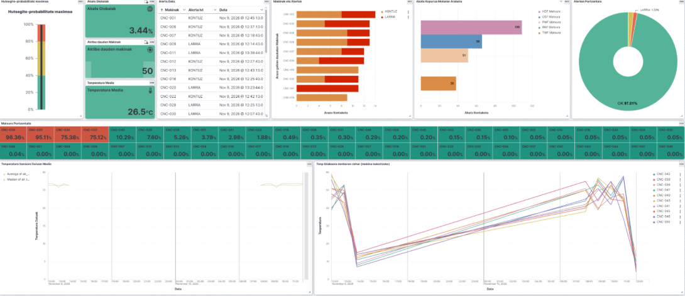


### 7.1. Kibana Data View eta Index Pattern-en konfigurazioa


Data View:


### 7.2. Panela eta bistaratzeak (KPIak, line chart-ak, heatmap-ak eta gertaera-taulak)


KPIak eta Metrika Nagusiak


Hutsegite-probabilitate maximoa (Gauge/Termometroa): Arrisku-maila maximoa adierazten du (berdea/horia/gorria).


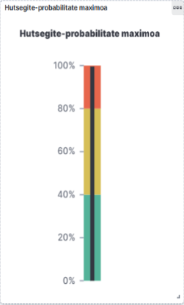


Akats Globalak: Instalazio osoko akatsen portzentaje orokorra.


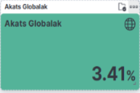


Aktibo dauden Makinak: Une honetan funtzionatzen eta datuak bidaltzen ari diren CNC makina kopurua.


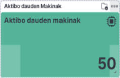


Tenperatura Media: Sentsore guztien batez besteko tenperatura orokorra.


Line Chart-ak


Tenperatura Sensore Datuen Media: Sentsoreen tenperaturaren bilakaera orokorra (media eta mediana) adierazten du denboran zehar.


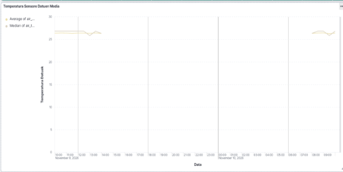


Tenp bilakaera denboran zehar (makina bakoitzeko): Makina bakoitzaren tenperaturaren bilakaera indibiduala erakusten duen linea-grafiko anitza. Honen bidez, makina jakin baten berotze ez-ohikoak detektatzen dira.


.png)


Heatmap-ak eta Desgaste Matrizea


Matxura Portzentaia: Makina bakoitzaren matxura edo desgaste portzentajea erakusten du kolore-eskala baten bidez. Gorri dauden makinek premiazko mantentzea behar dutela adierazten du.


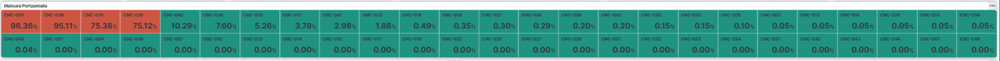


Gertaera-taulak


Alerta Data: Azken alerten erregistro xehatua denbora errealeko taula batean (Makinak, Alerta lvl, Data). Horrela, teknikariek azken gertaera larriak auditatu ditzakete.


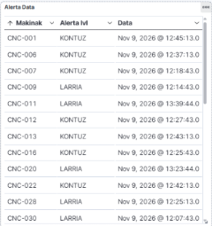


Beste Bistaratze Batzuk


Makinak eta Alertak: Arazo gehien dituzten makinak zerrendatzen ditu, alerta motaren arabera desglosatuta (KONTUZ vs LARRIA).


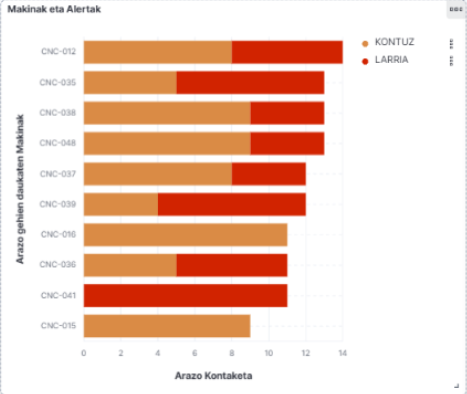


Akats Kopurua Motaren Arabera: Akats mota bakoitzaren maiztasuna erakusten du.


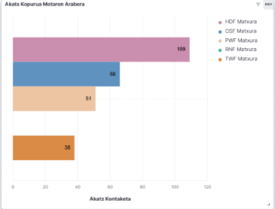


Alerten Portzentaia: Sistemaren egoera orokorraren banaketa.


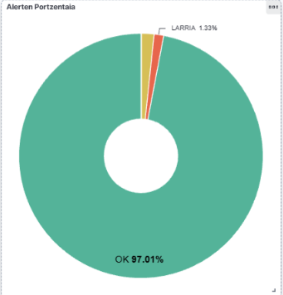


### 7.3. Denbora errealeko monitorizazioa eta sentsoreen jarraipena


Anomalien Detekzio Azkarra: Sentsoreen tenperatura-bilakaeran ohiko portaeratik aldentzen diren igoerak identifikatzeak makina jakin baten egoera aztertzen laguntzen du. Kibana-ko denbora-serieen bidez, teknikariek aldaketa horiek ikus ditzakete eta beharrezko ikuskapena lehenetsi.


Mantenimendu Prediktiboa eta Priorizazioa: Matxura Portzentaia eta Makinak eta Alertak grafikoen bidez, teknikari bati lehentasuna ematen zaio zein makinari egin behar dion ikuskapena matxura larriago bat gertatu aurretik.


Causa-Raíz Analisia: Alerta jakin bat hautatzean, iragazki dinamikoen bidez panel osoa makina horren tenperatura eta hutsegiteen historiala erakusteko egokitzen da. Horrek gertaeraren testuingurua aztertzen eta hutsegitearekin lotutako faktore posibleak identifikatzen laguntzen du, baina ez du berez kausalitatea frogatzen.

## 8. ONDORIOAK ETA ETORKIZUNEKO HOBEKUNTZAK

### 8.1. Lortutako emaitzen laburpena eta betetako helburuak

CNC Guard proiektuak arrakastaz inplementatu du industria 4.0 ingurunera bideratutako denbora errealeko mantentze prediktiboko arkitektura oso bat. Hasieran ezarritako helburu nagusi eta tekniko guztiak bete dira, datuen jatorritik hasi eta azken bistaratzera zein alerta-sistemara arteko fluxua ziurtatuz.

Lortutako lorpen nagusiak honako hauetan laburtzen dira:

#### 8.1.1. **Azpiegitura edukiontziratu sendoa eta isolatua:**
Docker eta Docker Compose bidez, 6 zerbitzu autonomo (Kafka, Filebeat, NiFi, Elasticsearch, Kibana eta Scoring API) modu errepikagarrian hedatzea lortu da.
#### 8.1.2. **Denbora errealeko ingesta malgua (Streaming):**
Windows-eko `N:` sare-unitate partekatu bidez CIFS/drvfs bidezko muntaketa eginez, Filebeat eta Kafkaren bidez 30 segundoro sartzen diren `.csv` sentsore-datuak inolako datu-galerarik gabe prozesatzea lortu da.
#### 8.1.3. **Machine Learning eredu eraginkorra eta optimizatua:**
AI4I 2020 datasetaren gainean egindako azterketa esploratzaile sakonari eta *Feature Engineering* lanari esker (3 aldagai eratorri berri sortuz: `power`, `temp_diff`, `torque_wear`), Random Forest eredua gailendu da. Klase-desoreka handiari (`%3,4` hutsegite soilik) `class_weight="balanced"` bidez aurre eginez eta atalase operatiboa `0,40`ra doituz, honako metrika sendoak lortu dira:
   - **Recall (%81,5):** Benetako hutsegiteen gehienak garaiz detektatzen dira, produkzio-geldialdi garestiak saihestuz.
   - **Precision (%81,5):** Alarma faltsuen kopurua gutxieneko mailan mantentzen da, mantentze-teknikarien turrusta-lanak ez kargatzeko.
   - **ROC-AUC (0,9792):** Ereduak gaitasun bikaina erakutsi du egoera arrunten eta anomaloen arteko bereizketa egiteko.
#### 8.1.4. **Scoring API azkarra eta segurua:**
FastAPI bidez garatutako mikrozerbitzuak 10 ms baino gutxiagoko latentziarekin erantzuten du, Pydantic bidezko datu-balidazio zorrotza egiten du eta `X-API-Key` bidezko segurtasuna zein AI Act araudira egokitutako auditagarritasuna bermatzen ditu.
#### 8.1.5. **Orkestrazio integratua eta Alerta Automatikoak:**
Apache NiFi-k datuen eraldaketa fisikoak (Kelvin -> Celsius) egin, ML APIarekin komunikatu, datuak bideratu eta anomalia larrien kasuan Telegram bidezko abisuak berehala bidaltzen ditu eragile teknikoen mugikorretara.
#### 8.1.6. **Eragiketa-panela Kibana-n:**
Mantentze-taldeek denbora errealean sentsoreen bilakaera, tenperatura-igoerak, akats-maiztasunak eta orokortutako KPIak aztertzeko Dashboard integratua eta iragazgarria eskuragarri daukate.

### 8.2. Sistematik hautemandako muga teknikoak

Sistemak harrera eta funtzionamendu ona erakutsi duen arren, garapen eta exekuzio fasean hainbat muga tekniko eta arkitektural identifikatu dira, etorkizuneko produkzio-inguruneei begira kontuan hartzekoak:

#### 8.2.1. **Docker Desktop (Windows/WSL2) muga-arkitekturalak:**
   - WSL2 eta Windows-eko sare-unitate partekatuen (`drvfs` / CIFS) arteko integrazioak baimen zein ikusgarritasun arazoak sortu ditu hasieran. Ekoizpen-ingurune errealetan (On-Premise Linux zerbitzari puruetan), ez da WSL2 geruzarik erabili behar, zuzeneko NFS/CIFS muntaketa bidez atzipen-denborak eta konplexutasuna murriztuz.
#### 8.2.2. **Batch jatorria eta denbora errealeko simulazioa:**
   - Datuak denbora errealean prozesatzen diren arren, iturburuko datuak 30 segundoro sortzen diren `.csv` fitxategi sorten (*batches*) bidez iristen dira. Benetako *Ultra-Low Latency* ingurune batean, sentsoreek datuak MQTT edo OPC-UA protokoloen bidez zuzenean Kafkara igorri beharko lituzkete, intermediate file-system geruza ezabatuz.
#### 8.2.3. **Ereduaren statizitatea eta kontzeptu-amaitzea (Concept Drift):**
   - Scoring APIak `.pkl` fitxategi statiko bat kargatzen du memorian. Ereduak ez du auto-ikaskuntzarik egiten, ezta sentsoreen higadura neurtzen denbora luzean zehar. Makina berriak sartzen badira edo funtzionamenduan aldaketak badaude, ereduaren zehaztasuna gutxitu egingo da.
#### 8.2.4. **In-Memory datu-transformatzeak NiFi barruan:**
   - NiFi-ko fluxuan JSON datuen transformazioak (`EvaluateJsonPath`, `JoltTransformJSON`) memoria asko kontsumitzen dute karga handiko ingurunetan. Prozesamendu banatua (adib. Apache Spark Streaming) egokiagoa litzateke segundoko milaka gertaera kudeatzeko.
#### 8.2.5. **Single Node arkitektura:**
   - Kafka, Elasticsearch eta NiFi nodo bakarrean exekutatzen dira (`single-node`). Ekoizpen-ingurune erreal batean, erredundantzia eta altuerako erabilgarritasuna (High Availability - HA) bermatzeko cluster anitzeko konfigurazioak behar dira.

### 8.3. Etorkizuneko lan-ildoak (MLOps, ereduaren birentrenamendua eta ezaugarri berriak)

Sistemaren eboluzioa bultzatzeko eta industria-ingurune erreal baterako jauzia egiteko, honako etorkizuneko lan-ildoak proposatzen dira:

#### 8.3.1. MLOps eta Birentrenamendu Automatizatua (Continuous Training)
- **MLflow / DVC Integrazioa:** Ereduen bertsionamendua, esperimentuen jarraipena eta artefaktuen (`.pkl`) biltegiratze egituratua ezartzea.
- **Drift Monitoring:** Sentsoreen datuen banaketa-aldaketak (*Data Drift*) eta ereduaren metrikak denboran zehar ikuskatzea (adib. Evidently AI bidez). Ereduaren errendimendua %75eko Recall-etik beherakoa bada, pipeline-ak birentrenamendu automatiko bat abiaraziko luke datu berriekin.
- **CI/CD Pipeline prediktiboa:** GitHub Actions bidez, eredu berri bat entrenatzen denean automatikoki balidazio-probak igaro eta Scoring APIko Docker irudia berrabiaraztea (Blue-Green deployment bidez, zerbitzua gelditu gabe).

#### 8.3.2. Ezaugarri eta Eredu Aurreratuagoak (Advanced AI)
- **Denbora-serieen analisia (LSTM / Transformers):** Praka bakarreko neurketak aztertu ordez, azken 10 minutuetako sentsoreen seinaleen sekuentziak aztertzea (recurrent neural networks bidez), bibrazio-patroiak edo tenperatura-kurben aldatsak hobeto hautemateko.
- **Survival Analysis (RUL - Remaining Useful Life):** Ez soilik "apurtuko den ala ez" esatea, baizik eta erremintari edo makinari zenbat minutu/ordu geratzen zaizkion estimatzea (*Remaining Useful Life* kalkulatzea regression bidez).

#### 8.3.3. Azpiegituraren eta Komunikazioen Hobekuntza
- **OPC-UA / MQTT sarrera:** Filebeat-en ordez, sentsore industrialen protokolo natiboak (OPC-UA / MQTT) Kafka Connect bidez zuzenean Kafkara bideratzea.
- **Kubernetes (k8s) orkestrazioa:** Docker Compose ordezkatzea Kubernetes bidez, Scoring APIaren eta Kafka brokerren eskalamendu automatikoa (Auto-scaling) ahalbidetuz eskaera-bolumenaren arabera.
- **Feedback Loop Interfazea (Human-in-the-Loop):** Kibanan edo mantentze-aplikazio baten bidez, teknikariek egindako ikuskapenen ondorioak (ea benetan matxura zegoen ala ez) sisteman atzera elikatzeko aukera ezartzea, etorkizuneko entrenamenduetan errore faltsuak zuzentzeko.
